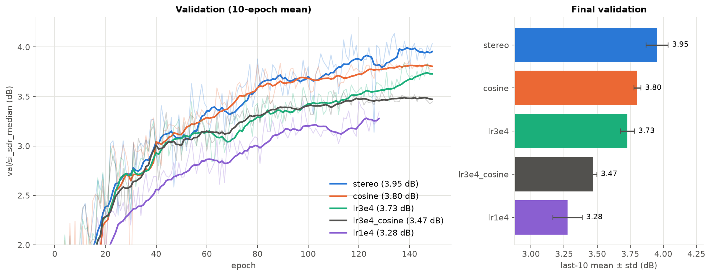
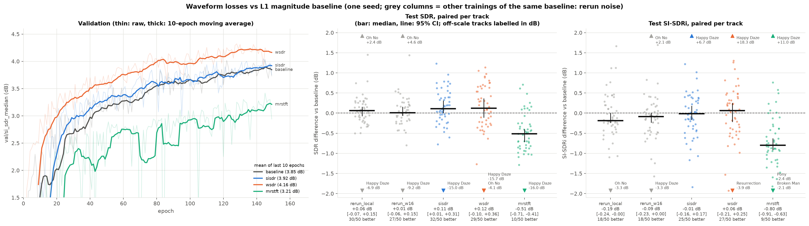
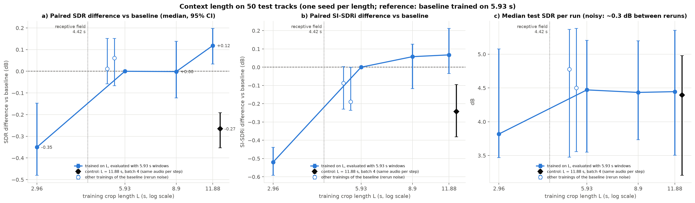
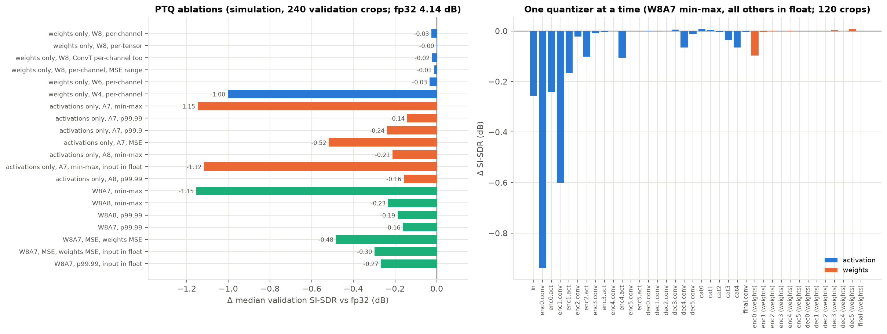

# Singing Voice Separation with a small U-Net

**Question.** How far can a small U-Net, sized to train in 4 GB of VRAM (my laptop), get on singing voice separation, and which ideas from more recent papers actually help it?

**Protocol.** 
MUSDB18 (compressed stems), 84 train / 16 val / 50 test tracks. 
Metric: stereo museval SDR, median over the 50 test tracks. 
One change at a time against a fixed baseline. 
**One training seed per run so far** (3-seed runs are set up but not run yet because of the training time length, see [Next steps](#next-steps)). 
Models are sized for a 4 GB laptop GPU (some of the latest runs were trained on a rented GPU to go faster, but the idea stays the same).

**Key numbers.** 
- Baseline (Jansson et al. 2017 U-Net, stereo, 9.8 M parameters): **4.50 dB SDR**. 
- Ideal-mask oracle with the same reconstruction: **9.09 dB**. 
- Doubling the width (39 M parameters, still fits in 4 GB): **+0.22 dB** paired [+0.13, +0.32].

**What I learned so far.**
1. The model gets about half of the oracle's SDR, and the gap is fairly regular across tracks: most of what's left to gain is in estimating the mask, not in the phase.
2. Capacity is what helps. A wider U-Net beats the baseline (+0.22 dB, and +0.42 dB for a 157 M model over budget). None of the tricks I tried does better than training noise (±0.15 dB): stereo input +0.04 dB, waveform losses +0.13/+0.14 dB, input compression or normalisation ~0, training on 2× longer crops +0.12 dB.
3. Some ideas from speech papers hurt here: compressing magnitudes in the loss (`|X|^0.3`) costs 0.8 dB, a multi-resolution STFT loss 0.5 dB. Lowering the learning rate, using cosine decay or training on 2× shorter crops also hurts.

**Status.** 8 experiments done (oracle, stereo, learning rate, waveform losses, amplitude compression, size, context length, int8). The baseline also runs in int8 at the same quality and 4× smaller (9.9 MB), but 2.3× slower on my CPU. Next: 3 seeds of the baseline, confirming the wider model.

---

## Why this project

I started by reimplementing the U-Net of [Jansson et al. (ISMIR 2017)](https://archives.ismir.net/ismir2017/paper/000171.pdf), one of the first deep U-Nets for voice separation. Then I wanted to turn it into a small research project: take ideas from more recent papers, state what I expect each one to change, test it against the baseline, and keep the negative results too.

The constraint that ties it together is my laptop GPU: a GTX 1650 Max-Q with **4 GB of VRAM**. Every model has to fit in that budget. The question is what a model that small can borrow from the state of the art.

**Where training actually runs.** All models are sized for 4 GB. The baseline peaks at 1.37 GiB during training (measured on the GTX 1650). But to get through experiments faster, I also rent a GPU (an A800 80 GB on AutoDL) and train several runs in parallel there. The 4 GB rule is about the model, not the machine: server runs aren't capped, so it's on me to measure peak VRAM locally before adding a model. 

Trained locally: the baseline, the mono model, the `cosine` run, and everything in the int8 experiment. 

Trained on the server: the other learning-rate runs and all of experiments 04 to 07 (each group with its own retrained baseline). Same code, data, split and seed. I trained `lr3e4_cosine` on both machines with the same seed (0.05 dB apart on validation), and the baseline three times with identical code, config and seed (once locally, twice on the server). Their median test SDRs are 4.50, 4.47 and 4.78 dB: one run's median moves by up to 0.3 dB. But their **paired** per-track differences stay within about ±0.15 dB, so that's the yardstick I use for every comparison. It only measures GPU non-determinism, not seed variability, until the 3-seed runs are done.

## The baseline

The model follows Jansson et al. 2017, with a few changes listed in [experiments/01](experiments/01_baseline_vs_oracle.md#differences-from-the-paper):

- Input: magnitude STFT of the mixture (44.1 kHz, 2048-point window, hop 512), one channel per audio channel.
- U-Net: 6 conv encoder blocks (5×5, stride 2, 16 -> 512 channels), 6 transposed-conv decoder blocks with skip connections, 50% dropout on the first 3 decoders. 9.8 M parameters.
- Output: a mask in [0, 1] (sigmoid). Estimated vocals = mask × mixture magnitude, recombined with **the mixture's phase**, then inverse STFT.
- Training: L1 loss on magnitudes, Adam 1e-3, random ~5.9 s crops, 150 epochs of 500 crops, batch 8.

**A bug I found along the way.** In my first version, the last decoder block still had BatchNorm + ReLU before the final 1×1 conv and sigmoid. Since the ReLU output is ≥ 0, the mask was capped at `sigmoid(bias)` and stuck at exactly that value wherever the ReLU output was zero. In the checkpoint trained with this bug, the mask never went above 0.727 and sat exactly at 0.727 on 46% of time-frequency bins (measured). I removed the ReLU/BN from that block (commit `68ba08f`). I don't have a clean before/after score: the only pre-fix run with a test score used an older evaluation pipeline and stopped at 47 epochs, so comparing it to the current baseline would mix several changes. A controlled rerun with the old head is on the to-do list.

## Results so far

| # | Experiment | Hypothesis | Result (test SDR unless stated) | Verdict | Details |
|---|---|---|---|---|---|
| 1 | Baseline vs oracle | There is a lot of headroom before the mixture phase becomes the limit | 4.50 dB vs 9.09 dB; gap 4.59 dB [4.11, 4.79]; model below oracle on 50/50 tracks | Confirmed | [01](experiments/01_baseline_vs_oracle.md) |
| 2 | Mono --> stereo input | Voice is more centred than the accompaniment, so stereo should help | +0.04 dB [−0.18, +0.17], p = 0.89 | Rejected (1 seed) | [02](experiments/02_mono_vs_stereo.md) |
| 3 | Learning rate / scheduler | A lower LR or cosine decay gives a stabler, better model | 1e-3 constant wins by 0.15 to 0.68 dB (validation) | Rejected | [03](experiments/03_lr_schedule.md) |
| 4 | Waveform losses | Training on the reconstructed waveform gives +0.3 to 1 dB | SI-SDR +0.11 dB, wSDR +0.12 dB, MR-STFT −0.51 dB [−0.71, −0.41] | Rejected (1 seed) | [04](experiments/04_waveform_loss.md) |
| 5 | Amplitude compression | `\|X\|^0.3` gives more weight to quiet bins and helps, mostly in the loss | in the loss −0.82 dB [−1.01, −0.64]; input only +0.07 dB; per-crop norm −0.01 dB | Rejected (1 seed) | [05](experiments/05_amplitude_compression.md) |
| 6 | Size/quality | A wider U-Net separates better, with diminishing returns | w4/w8 −0.85/−0.81 dB; w32 +0.22 dB [+0.13, +0.32]; w64 +0.42 dB | Confirmed, but no diminishing returns yet (1 seed) | [06](experiments/06_size_quality.md) |
| 7 | Context length | Longer training crops help a little, saturating past the 4.4 s receptive field | 2.96 s −0.35 dB; 8.90 s 0.00; 11.88 s +0.12 dB [+0.03, +0.20]; 11.88 s at batch 4 −0.27 dB | Rejected above 5.93 s (1 seed) | [07](experiments/07_context_length.md) |
| 8 | int8 quantization | int8 divides the size by 4 at a small quality cost, and QAT recovers it | PTQ with percentile ranges −0.02 dB [−0.07, +0.01]; QAT real int8 4.49 vs 4.50 dB; min-max ranges −0.63 dB; 39.3 --> 9.9 MB but **2.3× slower** on my CPU | Confirmed for size and quality, rejected for speed (1 checkpoint, 1 seed) | [08](experiments/08_int8_quantization.md) |

All CIs are 95% bootstrap intervals over the 50 test tracks. They only capture track-to-track variability, not seed-to-seed variability, which I haven't measured yet (three trainings of the same baseline stay within ±0.15 dB of each other, paired).

**These numbers aren't comparable to published results.** I evaluate on vocals + accompaniment instead of the official (compressed) mixture, I use compressed MUSDB18 rather than MUSDB18-HQ, and I haven't checked my evaluation against a published baseline. I read them as internal comparisons only.

### 1. How far is the baseline from its ceiling?

The oracle is the ideal mask, clipped to [0, 1] and applied to the mixture with the mixture's phase. It's the same reconstruction as the model, so it's the best this *kind* of model could do, not an absolute ceiling.


- The model reaches **49%** of the oracle's median SDR (4.50 vs 9.09 dB).
- Track difficulty is shared: the rank correlation between model and oracle SDR is 0.86 (Spearman). Tracks that are hard for the model are already hard for the oracle.
- The gap is fairly regular (median 4.6 dB, most tracks between 3 and 6 dB). It looks like a general "model" loss more than a few broken tracks. The 27.7 dB outlier is *PR - Happy Daze*, where the voice is almost inaudible, so its SDR doesn't mean much.

So there are ~4.6 dB to gain on the mask itself before having to deal with the phase (complex input or complex mask).

### 2. Does stereo help?

I measured that the voice is much more centred than the accompaniment: between 400 Hz and 12.8 kHz its Side/Mid ratio is 9 to 12 dB lower. So I expected a 2-channel model to use that cue.

| SDR median, stereo protocol | mono model | stereo model | paired difference |
|---|---|---|---|
| SDR | 4.51 dB | 4.50 dB | +0.04 dB [−0.18, +0.17], p = 0.89 |
| SI-SDRi | 9.29 dB | 9.31 dB | +0.03 dB [−0.13, +0.31], p = 0.45 |


No gain and no loss: stereo wins on 26 tracks out of 50. My best guess (not tested) is that the mono downmix *is* the Mid signal, so it already keeps the centred voice and drops part of the accompaniment. The mono model gets part of the cue for free. Also, the model only sees the magnitudes of L and R, not their phase difference. A Mid/Side input would give it the cue directly; that's a possible follow-up. I kept stereo as the baseline because it's the standard evaluation protocol. With one seed, this conclusion still needs the 3-seed runs to hold up.

### 3. Is the baseline badly tuned?

1e-3 is just Adam's default (the paper doesn't give a value), and the papers I read use lower values on other architectures. The baseline's validation curve was also noisy (0.32 dB between consecutive epochs). So I tested 3e-4, 1e-4 and cosine decay, picking on validation only.



| config | val SI-SDR, mean of last 10 epochs |
|---|---|
| **1e-3 constant (baseline)** | **3.95 ± 0.08 dB** |
| 1e-3 cosine | 3.80 ± 0.03 dB |
| 3e-4 constant | 3.73 ± 0.05 dB |
| 3e-4 cosine | 3.47 ± 0.03 dB |
| 1e-4 constant | 3.28 ± 0.11 dB (early-stopped at epoch 129) |

The higher the constant learning rate, the better, and the curve is still rising at epoch 150. That points to under-training, not to a learning rate that's too high. Cosine decay smooths the curve but costs 0.15 to 0.26 dB, probably because it shrinks the LR while the model is still learning. I kept 1e-3 constant. I didn't try higher than 1e-3, so a higher LR or more epochs might still do better.

### 4. Does training on the waveform help?

The L1 loss only looks at magnitudes, but I evaluate waveforms rebuilt with the mixture's phase. So I expected losses computed on the reconstructed waveform to gain +0.3 to 1 dB. I tried three, taken from speech papers: SI-SDR (Le Roux et al.), weighted-SDR (Choi et al.) and a multi-resolution STFT loss (Yamamoto et al.). All four runs, including a new baseline, were trained together on the server.



The two grey columns are other trainings of the same baseline (same config and seed): they show how much two trainings of the same model differ.

| loss | test SDR | Δ SDR vs baseline (paired) | better on | val SI-SDR (last 10 epochs) |
|---|---|---|---|---|
| L1 magnitude (baseline, server) | 4.47 dB | | | 3.85 ± 0.11 dB |
| SI-SDR | 4.71 dB | +0.11 [+0.01, +0.31] | 32/50 | 3.92 ± 0.08 dB |
| weighted-SDR | 4.63 dB | +0.12 [−0.10, +0.36] | 29/50 | 4.16 ± 0.09 dB |
| multi-resolution STFT | 3.88 dB | −0.51 [−0.71, −0.41] | 10/50 | 3.21 ± 0.13 dB |

- SI-SDR and wSDR gain about 0.1 dB, inside the gap between trainings of the same baseline. I can't call that a gain with one seed. wSDR has the best validation score of any w16 model, so it's the one to retest with seeds.
- All three waveform losses collapse on *PR - Happy Daze* (−15 to −16 dB), the track where the voice is almost inaudible. My guess: these losses are normalised by the target's energy, so they never push the model to output silence.
- The multi-resolution STFT loss is clearly worse, and its validation score drops by up to 4 dB from one epoch to the next while the training loss stays flat. That's my own 44.1 kHz adaptation of a speech-vocoder loss, so the conclusion is about this setup, not about MR-STFT in general.

I keep the L1 magnitude loss.

### 5. Does compressing the magnitude help?

The network sees raw magnitudes with 58 dB of dynamic range, and the linear L1 loss is dominated by loud low-frequency bins. Two speech-enhancement papers (Braun & Tashev, Wilson et al.) compress magnitudes with `|X|^0.3`, mostly in the loss. I tried it in the loss, in the input, in both, and a per-crop normalisation for volume invariance.


| config | test SDR | Δ SDR vs baseline (paired) | better on | val SI-SDR (last 10 epochs) |
|---|---|---|---|---|
| baseline (\|X\|, linear L1, server) | 4.47 dB | | | 3.85 ± 0.11 dB |
| `\|X\|^0.3` in the loss | 3.43 dB | −0.82 [−1.01, −0.64] | 5/50 | 2.74 ± 0.21 dB |
| `\|X\|^0.3` in the input | 4.52 dB | +0.07 [−0.09, +0.22] | 29/50 | 3.67 ± 0.24 dB |
| both | 3.36 dB | −0.98 [−1.11, −0.76] | 5/50 | 2.79 ± 0.10 dB |
| per-crop normalisation | 4.49 dB | −0.01 [−0.19, +0.19] | 24/50 | 3.79 ± 0.13 dB |

- Compressing the loss is the part the papers supported, and it's the part that hurts: −0.8 to −1 dB on test, better on only 5 tracks out of 50. I measured that the compressed target puts 12 times more weight above 16 kHz, where the AAC codec has cut most of the content (4.9% vs 0.4% of the total). I don't think that's the whole story. My other guess is that `x^0.3` is so steep near 0 that the loss pushes the mask to exactly zero wherever the voice is weak. I haven't tested it.
- Compressing only the input changes nothing measurable, and neither does normalisation on SDR. That's expected for `norm`: its job is volume robustness, which test tracks at their original level can't show. That test needs its checkpoint.

I drop compression in the loss and keep the baseline input.

### 6. Is a bigger model simply better?

Every other experiment changes *how* the baseline is trained. This one only changes its width (`base_channels` 4 to 64, i.e. 0.6 M to 157 M parameters), at the same 150-epoch budget. It's the background against which every trick should be read: is it worth more than a bigger model?


The middle panel is the one to read: paired difference against w16, with two other trainings of w16 (hollow) showing the rerun noise, and the two best loss variants (diamonds) at the same size.

| width | parameters | peak VRAM (1 step, GTX 1650) | Δ SDR vs w16 (paired) | better on |
|---|---|---|---|---|
| w4 | 0.62 M | 0.50 GiB | −0.85 [−1.20, −0.69] | 4/50 |
| w8 | 2.46 M | 0.74 GiB | −0.81 [−1.00, −0.63] | 3/50 |
| **w16 (baseline)** | 9.82 M | 1.28 GiB | | |
| w32 | 39.28 M | 2.63 GiB | **+0.22 [+0.13, +0.32]** | 35/50 |
| w64 | 157.11 M | 6.02 GiB (over budget) | +0.42 [+0.30, +0.54] | 44/50 |

- Above w16 each doubling gives about +0.2 dB, clearly above the rerun noise, and I don't see diminishing returns yet. Below w16 there's a cliff: w4 and w8 are both about 0.8 dB worse.
- **w32 is the best model I have under 4 GB**, and it beats every trick I tried (SI-SDR and wSDR: +0.13/+0.14 dB against this w16, CIs including 0). Its gain is probably underestimated: early stopping cut it at epoch 138 on a noisy validation peak, while its curve was still rising.
- One seed per width. Before adopting w32, I want it with early stopping off and 3 seeds.

### 7. Does a longer context help?

HT Demucs (Rouard et al. 2022) gains about 0.5 dB by training on 7.8 s instead of 3.4 s segments. But my U-Net's receptive field is only 4.42 s (measured), so past that a longer crop gives no output frame more context. I trained on 2.96, 8.90 and 11.88 s crops instead of 5.93 s, plus a control at 11.88 s with batch 4 (same audio per step as the baseline). All models are evaluated with the same 5.93 s windows.



| training crop | Δ SDR vs baseline (paired) | better on |
|---|---|---|
| 2.96 s | −0.35 [−0.48, −0.15] | 13/50 |
| 8.90 s | 0.00 [−0.12, +0.14] | 25/50 |
| 11.88 s | +0.12 [+0.03, +0.20] | 33/50 |
| 11.88 s, batch 4 | −0.27 [−0.35, −0.19] | 12/50 |

- Shorter crops hurt; longer ones stay within the rerun noise. At equal audio per step (batch 4) the long-crop model is even worse, so the longer context itself isn't what helps. The control also halves the batch and the number of crops, so I can't say exactly why it's worse.
- This fits the receptive-field argument. It also means attention at the bottleneck can't be justified by "more context" alone.
- I keep 5.93 s. Evaluating each model at its own window length (the HT Demucs protocol) is still to do.

### 8. Can the model be stored in int8?

Quantizing the weights to int8 divides the model size by 4. I quantized the baseline after training (PTQ) and with quantization-aware training (QAT), following Nagel et al. 2021 and Krishnamoorthi 2018, and ran the real int8 kernels on my CPU. This one runs locally, on one checkpoint.



| model (test, 50 tracks) | SDR | Δ SDR vs fp32 (paired) | better on |
|---|---|---|---|
| fp32 baseline | 4.50 dB | | |
| PTQ, min-max ranges | 3.72 dB | −0.63 [−0.75, −0.48] | 4/50 |
| PTQ, ranges clipped at the 99.99th percentile | 4.40 dB | −0.02 [−0.07, +0.01] | 21/50 |
| **QAT, real int8 on CPU** | **4.49 dB** | −0.00 [−0.07, +0.07] | 24/50 |
| *fp32 fine-tuned with the same 10 epochs, no quantizer* | *4.70 dB* | *+0.08 [+0.03, +0.16]* | *33/50* |

- Weights in int8 cost nothing; the whole cost is in the activations of the first two encoder layers, whose min-max ranges are blown up by outliers. Clipping the ranges at the 99.99th percentile fixes it even without QAT.
- QAT looks like +0.05 dB in simulation, but the fp32 control fine-tuned the same way gains +0.08 dB on its own: against it, the real int8 model is −0.07 dB. So int8 costs about 0 to 0.1 dB.
- **4× smaller (39.3 --> 9.9 MB), but 2.3× slower** on my CPU: the int8 transposed convolutions are 4× slower than in fp32, and the int8 convolutions are no faster. Making int8 fast would need a different decoder.

## The data, in short

Details and figures in [experiments/00](experiments/00_dataset.md).

- **Official mixture vs vocals + accompaniment.** In compressed MUSDB18, the mixture isn't exactly the sum of the stems. The residual is −30.7 dB below the mixture (median) and mostly above 17 kHz. Applying the oracle mask to the real mixture instead of the sum changes SI-SDR by 0.05 dB, so I train and evaluate on the sum.
- **The test set is skewed:** 72% Pop/Rock, no Rock/Pop/Singer-Songwriter/Jazz, no MedleyDB tracks. Per-genre scores outside Pop/Rock rest on 2 to 4 tracks.
- **Split:** train/val split by artist (no shared artist). 3 artists appear in both train and test (3 test tracks out of 50).

## Next steps

Everything below is **planned, not measured yet**. Each page has the hypothesis, the prediction and the protocol, written before running.

0. **3 seeds of the baseline, mono and stereo** (`seeds` group in [deploy/queue.yaml](deploy/queue.yaml), seeds 42/43/44 on the same machine). Without this I can't say whether a 0.1 to 0.3 dB difference is real, including "stereo brings nothing".
1. **Confirm w32**: early stopping off, 3 seeds. If the +0.2 dB holds, it becomes the final model under 4 GB. See [experiments/06](experiments/06_size_quality.md#decision).
2. **Analyses that need checkpoints from the server**: output level of the SI-SDR and wSDR models ([04](experiments/04_waveform_loss.md#whats-left)), volume sensitivity of `norm` and mask distribution of `power_loss` ([05](experiments/05_amplitude_compression.md#whats-left)), inference at other window lengths ([07](experiments/07_context_length.md#whats-left)), int8 of w32 ([08](experiments/08_int8_quantization.md#what-this-says)).
3. Smaller items: a controlled rerun of the head bug, training on the official mixture, a short audio demo.

## Ideas I'm not working on yet

These came out of the first training and my reading. They're further away, mostly because of the 4 GB budget or because they change several things at once.

- **Deal with the phase.** The mixture phase limits the model wherever the accompaniment dominates. Options: give the network the complex spectrogram, or estimate a complex mask whose magnitude can exceed 1, as in [Kong et al. (ISMIR 2021)](https://arxiv.org/abs/2109.05418), which decouples magnitude and phase estimation.
- **Better intermediate blocks**, like the TFC-TDF blocks of [Choi et al. (ISMIR 2020)](https://arxiv.org/abs/1912.02591).
- **Attention at the bottleneck.** After 6 stride-2 layers, each bottleneck position covers about 0.75 s × 1.4 kHz, so attention there would only see very coarse tokens. [07](experiments/07_context_length.md) showed that a longer context doesn't help this network, so attention would have to help some other way. I'd need to try it to know.
- **A second stage** that predicts a residual to clean up what the mask missed, as in [TS-BSMamba2 (Bai et al., 2024)](https://arxiv.org/abs/2409.06245).
- **Masks for several sources with shared weights**, as in [Kadandale et al. (2020)](https://arxiv.org/abs/2003.10414), so the instruments "compete" with the voice for each bin.
- **A generative approach**, which would recreate a clean voice in bins shared with instruments instead of averaging them. Probably below state of the art, but a different trade-off.

## Reproduce

Environment managed with [uv](https://github.com/astral-sh/uv), configs with Hydra, logs with W&B (project `VoiceSeparation`).

```bash
uv sync
uv run python -m src.train experiment=stereo                    # baseline (stereo)
uv run python -m src.train data.channels=1                      # mono model
uv run python -m src.evaluate CKPT -o outputs/eval_stereo.json  # test set, stereo museval SDR
uv run python -m analysis.baseline_vs_oracle outputs/eval_stereo.json --tag stereo
uv run python -m analysis.compare_runs outputs/eval_stereo.json outputs/eval_<name>.json
uv run python -m analysis.loss_study                             # experiment 04, from outputs/server/loss-v1
# experiment 05: same script with --run NAME=DIR (see experiments/05); 06: analysis.size_quality; 07: analysis.context_length
# experiment 08 (int8, runs locally): python -m src.quantize {ptq,sweep,sensitivity,ranges,qat,export,evaluate,profile} CKPT; figures with analysis.quantization
```

Each experiment page lists its own commands. Server runs go through `deploy/run_queue.py` (one group of [deploy/queue.yaml](deploy/queue.yaml) at a time).

## Repository layout

```
src/            model (models/unet.py), Lightning module, data, train / evaluate / inference, int8 quantization (quantization.py, quantize.py)
src/configs/    Hydra configs; experiment/ holds one file per experiment
analysis/       scripts that produce every figure and number in this README
experiments/    one page per experiment: hypothesis, protocol, results, discussion
figures/        generated figures
deploy/         scripts to run the experiment queue on a rented GPU
```

## References

- A. Jansson, E. Humphrey, N. Montecchio, R. Bittner, A. Kumar, T. Weyde, *Singing Voice Separation with Deep U-Net Convolutional Networks*, ISMIR 2017.
- Other papers are cited on the experiment pages where they're used: Loshchilov & Hutter 2017 ([03](experiments/03_lr_schedule.md)); Le Roux et al. 2018, Choi et al. 2019, Yamamoto et al. 2020 ([04](experiments/04_waveform_loss.md)); Braun & Tashev 2020, Wilson et al. 2018 ([05](experiments/05_amplitude_compression.md)); Rouard et al. 2022 ([07](experiments/07_context_length.md)); Nagel et al. 2021, Krishnamoorthi 2018 ([08](experiments/08_int8_quantization.md)).
