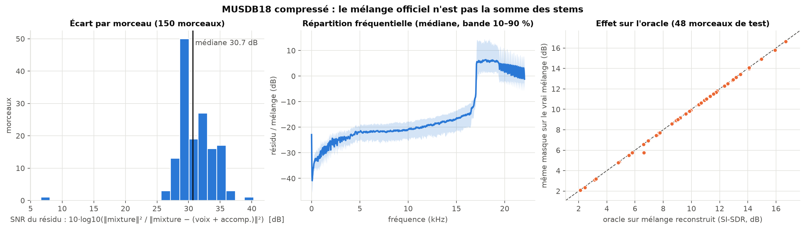
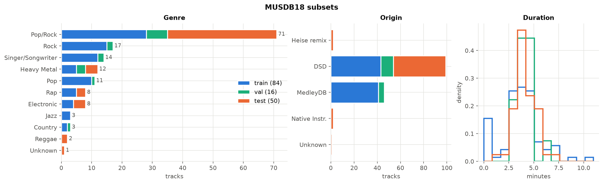
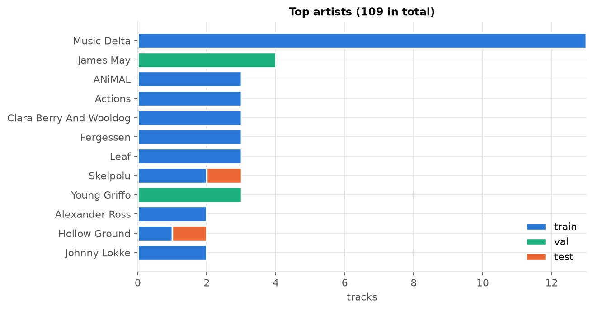
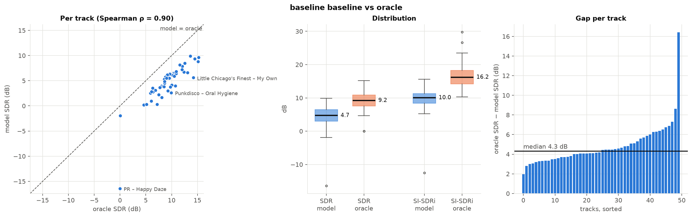
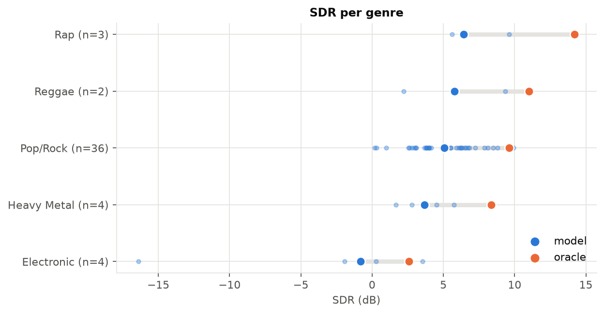
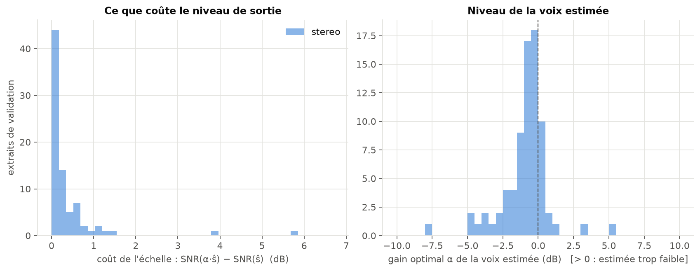

# Singing Voice Separation
L'idee de ce projet est de tests l'avancer des modeles dans la sereparation de voix musicale avec les instruments qui compose l'audio.

Les contraintes qui vont servir de base sont celle du materielle utilise et serviront de fil conduteur.
4Go de vram pour l'entrainement, donc comment un petit model peut utiliser l'avancer de l'etat de l'art pour parvenir à realiser cette tache.

## 0. Creation Baseline avec modele historique ([Jansson et al., *Singing Voice Separation with Deep U-Net Convolutional Networks*, ISMIR 2017](https://archives.ismir.net/ismir2017/paper/000171.pdf))
Pour commencer, j'ai reimplementé la base qui sert de base au domaine avec un UNet. Il consiste d'un encodeur-decoder avec des couches de convolution et concatenation. L'entree du modele est la magnitude d'un son mono, puis on applique un stft en sorti de decoder on va vont venir construire un masque entre [0, 1] pour permettre de definir la quantite de voix pour chaque temps x fequence. Ce masque permet ensuite la reconstruction du morceau via la phase de la mixture + le voix estime (mixture * masque).

## 1. Dataset MUSDB18
Le dataset utilise est le MUSDB18, donc la version mixture est compressé et n'est pas exactement egale à voix + instrumental, donc pour l'apprentissage on utilise la mixture real qu'on reconstruit avec la voix + instrumental. Donc en inference on à une erreur interne au model.

### Variation entre la mixture officielle et voix + instrumental

(`python -m analysis.mixture_gap`, sur les 150 morceaux)



- Le residu `mixture − (voix + instrumental)` est a **−30,7 dB** de la mixture en median (10e percentile : −28,4 dB ; entre −26 et −39 dB pour tous les morceaux sauf un, voir plus bas). L'ecart est donc faible.
- Il est concentre au-dessus de **17 kHz** (residu superieur a la mixture au-dela, probablement a cause de la coupure passe-bas de l'encodage AAC, non verifie), c'est-a-dire dans une zone ou il n'y a presque pas d'energie utile.
- Pour savoir si ca a un impact sur la separation, j'ai calcule le masque oracle sur la mixture reconstruite puis je l'ai applique a la vraie mixture (48 morceaux de test avec voix exploitable, 3 extraits de 6 s chacun) : SI-SDR median de **10,21 dB** (mixture reconstruite) contre **10,17 dB** (vraie mixture), soit **0,05 dB** d'ecart median. L'erreur interne est donc negligeable pour ce probleme.
- Exception : *PR - Oh No* (mixture a seulement 7,6 dB du residu) et *PR - Happy Daze*, deux morceaux Native Instruments dont la voix est quasi inaudible (RMS median de −86 dB pour *Happy Daze*, 67 % des fenetres de 1 s sous −60 dB). Le residu y est plus fort que la voix (SNR voix/residu minimal de −9,4 dB).

[TODO]{test entrainement avec vraie mixture et comparer} : le proxy ci-dessus (oracle) suggere un effet quasi nul, mais le test complet (entrainer et evaluer sur `mixture.wav`) n'est pas encore lance.

### Repartition des sons (style, interprete)

(`python -m analysis.dataset_distribution`)



| Genre | train (84) | val (16) | test (50) |
|---|---|---|---|
| Pop/Rock | 33 % | 44 % | **72 %** |
| Rock | 18 % | 12 % | 0 % |
| Singer/Songwriter | 14 % | 12 % | 0 % |
| Heavy Metal | 6 % | 19 % | 8 % |
| Pop | 12 % | 6 % | 0 % |
| Rap | 6 % | 0 % | 6 % |
| Electronic | 5 % | 0 % | 8 % |
| Jazz | 4 % | 0 % | 0 % |
| Country | 2 % | 6 % | 0 % |
| Reggae | 0 % | 0 % | 4 % |
| inconnu (absent du README MUSDB) | 0 % | 0 % | 2 % |

- Le test est tres desequilibre : 72 % de Pop/Rock, **aucun** Rock, Singer/Songwriter, Pop ni Jazz, et il ne contient aucun morceau MedleyDB (que des DSD, 2 Native Instruments et 2 du concours Heise). Les morceaux MedleyDB (46 % du train+val) ne servent donc qu'a l'entrainement.
- Le reggae n'apparait qu'en test (2 morceaux) et le jazz qu'en train (3). Les scores par genre sur le test reposent sur 2 a 4 morceaux pour tous les genres sauf Pop/Rock (36) : a prendre comme des ordres de grandeur.
- Interpretes : 3 artistes sont a la fois dans le train et le test (*Hollow Ground*, *Skelpolu*, *The Long Wait*), soit 3 morceaux de test sur 50. Le split train/val est fait par artiste, il n'y a aucun artiste commun entre train et val.
- Durees : mediane autour de 4 min dans les trois sous-ensembles ; le train contient quelques morceaux tres courts (*Music Delta*, de 13 a 26 s) et le plus long fait 10,5 min.



## 2. Iteration
Lors de l'implementation, j'ai pu me rendre compte que la tete du reseau appliquait un ReLu en trop et donc venait plafonner la sortie de 46% des cellules ce qui reduisait fortement l'apprentissage.

Ce papier fondateur donne des resultats qui ne sont pas comparable à d'autre papier mais j'ai pu utiliser un oracle qui va venir definir un plafond pour l'estimation.

Avec ce premiere entrainement, on peut se rendre compte de nombreux point qui pourrait etre ameliore pour essaye de donner plus de contexte au modele:
- l'utilisation de la phase de la mixture ne permet pas de correctement reconstruire les frequence ou les instruements etait dominant. Pour ce faire on pourrait le donner en entree comme à pu le faire [Choi et al., ISMIR 2020](https://arxiv.org/abs/1912.02591) (U-Net entraines sur le spectrogramme complexe) ou estimer directement un masque complexe, dont l'amplitude peut depasser 1, comme [Kong et al., ISMIR 2021](https://arxiv.org/abs/2109.05418) (ResUNet qui separe l'estimation de l'amplitude et celle de la phase), ce qui implique d'utiliser soit 2 canaux pour apprendre le masque ou bien apprendre un masque complexe, à verifier ci l'apprentissage est faisable sur la machine.
- la compression en signal mono est egalement un approximation qui peut etre facilement change dans l'etat actuel en gardant le stero et en doublant les canaux d'entree.
- pour tenter d'ajouter des notions plus recente on peut modifier le bottlenet pour y ajouter de l'attention comment à pu le faire à son epoque le papier avec son RNN, on pourrait donc ajouter un Transformer meme si l'information est enormement compressé à ce niveau et que pour avoir de l'attention vraiment interessant il faudrait augementer le nombre de canaux recu au bottlenet et donc augementer la taille de l'entree, a voir si cela est faisable sur la machine.
- une autre idee qui a ete introduit par le papier [TS-BSMamba2, Bai et al., 2024](https://arxiv.org/abs/2409.06245) (premier etage de masquage, puis second etage qui apprend un residu pour corriger ce que le masque a manque) est d'utiliser un second model par la suite pour essayer de supprimer les residues d'instrument dans l'output.
- une approche de generation, meme si moins bon que l'etat de l'art actuel, pourrait etre utilise avec comme idee de ne pas creer de son qui est simplement une moyenne mauvaise entre la voix et l'instrument pour les frequences partage mais de toujours recreer un voix pur dans cette situation.
- dans la meme logique de separation des frequences partage, l'instoration de mask pour l'instrumental avec des poids partage pourrait egalement aide comme à pu le faire [Kadandale et al., *Multi-channel U-Net for Music Source Separation*, 2020](https://arxiv.org/abs/2003.10414) (un seul reseau pour plusieurs sources, entraine avec une loss multi-taches ponderee)

Chaque iteration sera ensuite documente avec pour idee démetre une hypothese que le changement dans le modele pourrait apporter/corrige et de comparer les resultats avec l'hypothese.

### 0. Comparaison baseline avec oracle

Actuellement apres avoir, corrige les problemes d'implementation et sans augmentation de donnees, la baseline est fixe sur le jeu de test à :
SDR médian sur 50 morceaux : 4.70 dB  IC95% bootstrap [3.80, 5.92]
SI-SDRi médian sur 50 morceaux : 10.03 dB  IC95% bootstrap [8.80, 10.60]
SDR médian oracle : 9.21 dB  IC95% bootstrap [8.55, 10.24]
SI-SDRi médian oracle : 16.20 dB  IC95% bootstrap [14.72, 17.32]

(`python -m analysis.baseline_vs_oracle`, a partir de `outputs/oracle_baseline.json`)



L'oracle est le masque ideal borne a [0, 1] applique a la mixture avec sa phase (meme reconstruction que le modele). C'est donc le meilleur resultat possible pour ce type de modele, pas un plafond absolu.

- **Le modele atteint environ la moitie de l'oracle** : 4,70 dB contre 9,21 dB, soit un ecart median de **4,32 dB** (IC95 % bootstrap [4,04, 4,69]). le modèle est moins bon que l’oracle sur 50 morceaux sur 50. Il reste environ 4,3 dB de marge sur l’estimation du masque, avant d’atteindre la limite imposée par la phase de la mixture. Au-delà, l’amélioration demanderait de traiter la phase (entrée complexe ou masque complexe).
- **La difficulte vient surtout du morceau** : la correlation de rang entre SDR du modele et SDR de l'oracle est de **0,90** (Spearman). Les morceaux difficiles pour le modele le sont deja pour l'oracle (voix noyee dans l'instrumental, bins ou voix et instruments se superposent).
- **L'ecart oracle − modele est assez regulier** (mediane 4,3 dB, la plupart des morceaux entre 3 et 6 dB), ce qui plaide pour une perte « de modele » plutot que pour quelques cas pathologiques. La valeur extreme a 16,4 dB (*PR - Happy Daze*) est un artefact : la voix y est quasi inaudible (voir plus haut), son SDR oracle vaut 0,00 dB et le SDR du modele −16,4 dB, alors que son SI-SDRi oracle est de 29,8 dB. Les deux morceaux PR sont les seuls du test avec un SDR oracle quasi nul et tirent le genre « Electronic » vers le bas.
- **Le SDR median est une mesure plus severe que le SI-SDRi** (4,70 contre 10,03 dB pour le modele) : le SDR museval penalise la distorsion de la voix et pas seulement la fuite d'instruments, et il est calcule par fenetre de 1 s. Ces chiffres sont en mono sur MUSDB18 compresse avec une mixture reconstruite, et ne sont **pas comparables** aux papiers (stereo, MUSDB18-HQ, cSDR).
- **Par genre** (figure ci-dessous), l'ecart est le plus grand sur le Rap (+5,6 dB, n = 3) et le Reggae (+5,2 dB, n = 2) ; Pop/Rock (n = 36) est a +4,2 dB. Avec 2 a 4 morceaux par genre en dehors du Pop/Rock, ces differences ne sont pas significatives.



Cette baseline est entrainee sans augmentation de donnees : le chiffre sert de reference pour les iterations suivantes, a comparer avec `python -m analysis.compare_runs`.

### 1. Passage de Mono à Stereo 

l'idee est que le stereo donne une information spacial sur le son avec la voix qui est majoritairement regroupe au centre alors que les instruments sont repartie sur l'ensemble du spectre.

(`python -m analysis.stereo_analysis`) Decomposition Mid = (L+R)/2 (c'est exactement le mono du pipeline) et Side = (L−R)/2 : une source au centre a un Side proche de zero.


Sur les 94 morceaux d'entrainement/validation avec une voix exploitable (fenetre centrale de 20 s) :


| | voix | accompagnement |
|---|---|---|
| correlation L/R mediane | 0,94 | 0,84 |
| energie dans Side (mediane) | 3,0 % | 8,4 % |
| Side/Mid median | −15,1 dB | −10,4 dB |
| Side/Mid median entre 400 Hz et 12,8 kHz | −15 a −19 dB | −6 a −7 dB |
| morceaux quasi mono (correlation > 0,95) | 48 % | 12 % |

L'hypothese est confirmee en tendance : la voix est plus centree que l'accompagnement (correlation plus forte sur 72 % des morceaux), avec **un ecart de 9 a 12 dB de largeur stereo** entre 400 Hz et 12,8 kHz, la ou se trouve l'essentiel de la voix. En dessous de 100 Hz les deux sont centres (basse, grosse caisse), donc la stereo n'aide pas sur les graves. Mais ce n'est pas une regle : 52 % des voix ont une correlation inferieure a 0,95 (10e percentile de correlation a 0,64 : reverb stereo, doublages), et 12 % des accompagnements sont quasi mono. Le modele doit donc apprendre un indice utile mais bruite, pas appliquer un filtre « centre ».

l'ajout de ce second canal devrait permettre au modele d'utiliser cette information pour trouver des liens dans les frequences afin de mieux separer dans le masque.

Pour que la comparaison soit juste, les deux modeles ont ete evalues sur les 50 morceaux de test dans les deux protocoles (**mono** : references et estimation mixees en mono ; **stereo** : 2 canaux, le modele mono etant applique separement a L et a R). Un premier resultat comparait la baseline mono evaluee en mono au modele stereo evalue en stereo (4,70 contre 4,50 dB) et laissait croire a une perte de 0,3 dB : c'etait en grande partie un effet de protocole, le meme modele mono passant de 4,70 a 4,51 dB quand on le note en stereo.

| SDR median [IC95 % bootstrap] | modele mono | modele stereo | difference appariee stereo − mono |
|---|---|---|---|
| protocole mono | 4,70 dB [3,80 ; 5,92] | 4,89 dB [3,78 ; 5,70] | −0,06 dB [−0,35 ; +0,18], p = 0,44 |
| protocole stereo | 4,51 dB [3,52 ; 5,47] | 4,50 dB [3,56 ; 5,38] | +0,04 dB [−0,18 ; +0,17], p = 0,89 |
| SI-SDRi, protocole stereo | 9,29 dB | 9,31 dB | +0,03 dB [−0,13 ; +0,31], p = 0,45 |
| oracle (protocole mono / stereo) | 9,21 / 9,09 dB | | |


(protocole stereo, SDR, sans les 2 morceaux *PR* dont la voix est quasi inaudible ; avec les 50 morceaux la difference mediane est de +0,04 dB, sans eux de +0,05 dB)

- **Le stereo n'apporte aucun gain mesurable, mais pas de perte non plus.** Les differences sont de l'ordre de 0,05 dB, tous les intervalles contiennent 0, et le stereo gagne sur 26 morceaux sur 50 : un pile ou face.
- **L'indice spatial existe pourtant** (voix 9 a 12 dB plus centree que l'accompagnement, voir plus haut). Explication possible, non testee : le mixage mono garde le Mid, donc deja la voix centree, et retire une part plus grande de l'accompagnement (3 % de l'energie de la voix est dans le Side, contre 8,4 % pour l'accompagnement) ; le modele mono beneficie donc d'une partie de l'indice gratuitement. Une autre possibilite, egalement non testee : le modele ne recoit que l'amplitude de L et R, donc pas la difference de phase, et doit retrouver « L ≈ R » avec sa premiere convolution (2 → 16 canaux). Un signal Mid/Side (ou un masque unique applique au Mid) donnerait l'indice directement : piste suivante possible.
- **Precautions** : une seule graine par configuration (on ne connait pas la variabilite entre deux entrainements, voir `docs/ROADMAP.md`, etape 0), donc des differences de l'ordre de 0,1 a 0,3 dB ne sont pas interpretables. Les intervalles ne mesurent que la variabilite entre morceaux.
- **Decision : on ne travaille plus qu'en stereo.** Le modele stereo est la nouvelle baseline (SDR median 4,50 dB, oracle 9,09 dB, ecart a l'oracle 4,59 dB) et `src.evaluate` n'evalue plus qu'en stereo (2 canaux, SDR BSSEval sur 2 canaux, protocole de la litterature). Comme il n'y a plus de comparaison mono / stereo a faire, l'evaluation est deux fois moins longue. Les chiffres restent non comparables a ceux des papiers (MUSDB18 compresse, melange reconstruit, SDR sur fenetres de 1 s). Comparaison de deux checkpoints : `python -m analysis.compare_runs outputs/eval_stereo.json outputs/eval_<nom>.json`.

### 2. Compression de l'amplitude (loi de puissance)

**Hypothese.** Le reseau recoit |X| brut, sans normalisation, et la loss L1 est dominee par les bins forts (graves, passages forts). Comprimer l'amplitude par une loi de puissance `|X|^c`, `0 < c < 1`, devrait donner plus de poids aux bins faibles (aigus de la voix, sibilantes) et reduire la dependance au niveau sonore du morceau.

**Ce que disent les etudes** (lues en entier, voir les references) :

| | Braun & Tashev | Wilson et al. |
|---|---|---|
| tache | rehaussement de la parole (reverberee, CHiME2), reseau recurrent de 2,8 M de parametres | rehaussement de la parole mono/bi-canal (CHiME2 WSJ0), masque de spectrogramme, faible latence |
| ou est appliquee la compression | **dans la loss** : distance entre amplitudes compressees (« compressed MSE », eq. 11-12) ; l'entree du reseau est un log-spectre de puissance **normalise en moyenne et variance en ligne** | **partout** : entree du reseau, representation sur laquelle le masque est applique, et loss : « all spectra are power-law compressed (with power 0.3) » |
| exposant | « a commonly used compression exponent is c = 0.3 » | 0,3 |
| justification et resultat | la loss compressee (avec la MAE) est la meilleure des distances testees, « which can be attributed to a better match to the signal distributions » ; melangee a une loss complexe (β = 0,3) elle donne le meilleur PESQ ; compression benefique sur donnees reverberees reelles | « partially equalizes the importance of quieter sounds relative to loud ones » |

**Ce que ces etudes ne montrent pas, et qui borne notre conclusion.**
- Ce sont des travaux de **rehaussement de la parole, pas de separation musicale** : on teste ici si l'idee transfere (une voix chantee sur un melange dense de plusieurs instruments, sur du MUSDB18 compresse, avec un U-Net 2D de 9,8 M de parametres).
- **Aucun des deux n'isole l'effet de la compression de l'entree.** Braun & Tashev comparent des *loss* (la compression est un ingredient de la loss ; leur entree est un log-spectre normalise, pas une loi de puissance) et Wilson et al. appliquent 0,3 partout sans ablation d'exposant dans le texte. Les preuves portent donc surtout sur la **loss** ; la compression de l'entree est ici une extrapolation de Wilson et al.
- Leurs metriques sont PESQ et SI-SDR sur de la parole, pas le SDR BSSEval sur de la musique.
- Ni l'un ni l'autre ne traite l'invariance au volume : Braun & Tashev utilisent une normalisation en ligne de l'entree, ce qui est une autre idee (voir `norm` ci-dessous).

**Ce que recoit notre reseau** (`python -m analysis.input_amplitude`, 80 extraits de validation et 100 morceaux) :


- La mediane de |X| est de 0,059 et le 99,9e percentile de 47 (maximum 263) : **58 dB de dynamique** entre la mediane et le 99,9e percentile. 87 % des bins sont sous 1, zone ou `log1p(|X|) ≈ |X|` : `log1p`, que la feuille de route proposait, ne comprime que les 13 % de bins forts et n'est pas ce que font les etudes ; on retient donc la loi de puissance `c = 0,3`.
- 22,8 % des bins sont quasi vides (|X| < 1e-3) : coupure de l'encodage AAC vers 16 kHz.
- **Les morceaux different de 10 dB de volume** entre le 10e et le 90e percentile (de −19 a +4 dB pour le niveau moyen de |X|).
- La loss L1 lineaire est dominee par les graves (niveau moyen jusqu'a +27 dB, contre environ −80 dB au-dessus de 16 kHz).

**Le modele actuel est-il sensible au volume ?** Oui. On multiplie le melange par un gain, puis on mesure le SI-SDR de validation (invariant a l'echelle de la sortie : seul le masque compte) et l'ecart du masque par rapport au gain 0 dB, pour la baseline stereo :


| gain applique | −18 dB | −12 dB | −6 dB | +6 dB | +12 dB | +18 dB |
|---|---|---|---|---|---|---|
| Δ SI-SDR (baseline stereo) | −2,64 | −0,99 | −0,15 | −0,35 | −0,99 | −1,32 |
| ecart moyen du masque | 0,17 | 0,12 | 0,06 | 0,06 | 0,12 | 0,17 |

- Le masque change avec le volume et **sa valeur moyenne monte avec le gain** (de 0,43 a 0,50 entre −6 et +12 dB) : le reseau laisse passer plus de signal quand le morceau est plus fort. La perte est faible dans la plage normale (≤ 0,35 dB pour ±6 dB), franche a ±12 dB et au-dela, et dissymetrique (baisser le volume coute un peu plus que le monter).
- **Une loi de puissance ne rend pas l'entree invariante au volume** (panneau a) : le decalage de l'entree du reseau sous +6 dB vaut 0,23 ecart-type sans transformation, **0,25 avec `|X|^0,3`**, 0,26 avec `log1p` ou `sqrt`. C'est ce decalage que la BatchNorm en inference ne sait pas absorber. Seule une normalisation par extrait (`norm`) l'annule (0,00). La compression sert donc surtout a rebalancer l'importance des bins faibles, pas a regler le volume.

**Experiences** (une seule variable change par rapport a la baseline stereo ; reglages dans `src/configs/experiment/`, code dans `src/utils/input_transform.py` et `src/module.py`) :

| config | entree du reseau | loss | ce qu'elle teste | commande |
|---|---|---|---|---|
| baseline | \|X\| | L1(\|X̂\|, \|S\|) | reference (deja faite) | `uv run python -m src.train experiment=stereo` |
| power_loss | \|X\| | L1(\|X̂\|^0,3, \|S\|^0,3) | la compression dans la loss (Braun & Tashev) | `uv run python -m src.train experiment=stereo_power_loss` |
| power_in | \|X\|^0,3 | L1 lineaire | la compression de l'entree seule (Wilson et al., extrapolation) | `uv run python -m src.train experiment=stereo_power_in` |
| power_both | \|X\|^0,3 | L1(\|X̂\|^0,3, \|S\|^0,3) | les deux, comme Wilson et al. (sauf le masque, qui reste applique a l'amplitude lineaire) | `uv run python -m src.train experiment=stereo_power_both` |
| norm | \|X\| / moyenne par extrait de 6 s | L1 lineaire | l'invariance exacte au volume | `uv run python -m src.train experiment=stereo_norm` |

Choix de conception : le masque reste dans [0, 1] et applique a l'amplitude lineaire du melange (`X̂ = masque · |X|`), seule la distance de la loss et l'entree changent ; la loi de puissance est `(|X| + 1e-8)^c` (la derivee de `x^c` est infinie en 0, et 22,8 % des bins sont quasi nuls). Avec `c = 1` on retrouve exactement la baseline (verifie). `val/loss` n'est comparable qu'entre modeles de meme exposant de loss : l'arret anticipe et le checkpoint s'appuient sur `val/si_sdr_median`.

Ordre propose : **`power_loss` d'abord** (c'est la ou les etudes montrent un effet), puis `power_in`, puis `power_both` si l'un des deux aide, et `norm` pour le volume. 3 a 4 entrainements d'environ 30 min, une seule graine chacun : un ecart de quelques dixiemes de dB n'est pas interpretable seul.

```
uv run python -m src.evaluate CKPT -o outputs/eval_stereo_power_loss.json
python -m analysis.compare_runs outputs/eval_stereo.json outputs/eval_stereo_power_loss.json --names stereo power_loss
python -m analysis.input_amplitude --ckpt stereo=<ckpt baseline> --ckpt power_loss=<ckpt power_loss>
```

Attendu (⚠ estimations, pas des mesures) : gain de SDR modeste (moins de 0,5 dB) pour `power_loss`, a confirmer sur de la musique ; pas d'invariance au volume pour les variantes `power`. Si l'hypothese est infirmee, cela voudrait dire que l'ecart de dynamique entre bins forts et faibles ne limite pas ce modele, ou que l'avantage observe en parole ne se transfere pas a la musique. Resultat : [TODO]{entrainer, evaluer et comparer}.

**References**
- S. Braun, I. Tashev, *A consolidated view of loss functions for supervised deep learning-based speech enhancement*, arXiv:2009.12286, 2020 ([arXiv](https://arxiv.org/abs/2009.12286)). Lu en entier ; la page arXiv ne donne pas de conference ni de revue, a completer avant de citer ailleurs.
- K. Wilson, M. Chinen, J. Thorpe, B. Patton, J. Hershey, R. F. Saurous, J. Skoglund, R. F. Lyon, *Exploring Tradeoffs in Models for Low-latency Speech Enhancement*, arXiv:1811.07030, 2018 ([arXiv](https://arxiv.org/abs/1811.07030)). Lu en entier ; meme remarque sur la conference.

### 3. Changement de la loss

**Hypothese.** La loss de la baseline (L1 sur l'amplitude) n'est pas ce que l'on mesure. L'evaluation compare des *formes d'onde*, obtenues apres iSTFT avec la phase du melange ; la loss ne regarde que l'amplitude avant reconstruction, et ignore donc l'effet de la phase du melange et de l'iSTFT (la STFT modifiee n'est plus forcement coherente). Entrainer directement sur la forme d'onde reconstruite (`_to_wave`, deja differentiable) devrait rapprocher l'optimisation du SDR/SI-SDR evalue.

**Ce que disent les etudes** (lues en entier, voir les references) :

| | Le Roux et al. | Choi et al. | Yamamoto et al. |
|---|---|---|---|
| contribution | definit le **SI-SDR** et montre les defauts du SDR de BSS eval | **weighted-SDR (wSDR)**, loss sur la forme d'onde apres iSTFT | **STFT multi-resolution** (convergence spectrale + magnitude log) |
| tache | definition de metrique ; exemples sur de la parole (CHiME2) et comparaison sur wsj0-2mix | rehaussement de la parole (VoiceBank-DEMAND, 16 kHz), masque complexe borne par tanh | vocodeur neuronal de parole (TTS, 24 kHz) |
| ce qui est montre | SDR et SI-SDR different d'environ 0,5 dB (0,3 a 0,6) sur wsj0-2mix ; le SDR de BSS eval peut rester eleve alors qu'une partie du spectre est supprimee | « almost every result shows that optimizing with wSDR loss gives the best result » face a MSE spectrogramme et MSE forme d'onde, sur 3 masques x 3 tailles de reseau ; mais la MSE spectrogramme donne souvent un meilleur PESQ (DCU-10, DCU-16) | la loss multi-resolution donne un meilleur MOS que la meme loss a une seule resolution ; elle « prevents the generator from being overfit to a fixed STFT representation » |

**Ce que ces etudes ne montrent pas, et qui borne notre conclusion.**
- Aucune ne traite de **separation musicale**. Choi (parole bruitee, 16 kHz, masque complexe), Yamamoto (synthese vocale, evaluee par ecoute) et Le Roux (metrique) portent sur autre chose : on teste si l'idee transfere a une voix chantee sur un melange dense.
- Le Roux et al. **ne proposent pas** d'entrainer avec le SI-SDR : l'article definit la metrique et cite d'autres travaux qui l'utilisent comme loss (« outperforming least-squares on some tasks »). Le lien avec la loss est donc notre extrapolation.
- L'argument « sensible a la phase » de Choi vient d'un masque **complexe** qui corrige la phase. Ici le masque est reel dans [0, 1] et la phase est celle du melange, fixe : la loss ne peut agir que sur l'amplitude. Le gain attendu est borne par ce plafond (oracle 9,09 dB contre 4,50 dB pour le modele : l'ecart est surtout celui du modele, pas du plafond de l'amplitude).
- Yamamoto n'a pas de resolution definie pour 44,1 kHz ni de separation de sources : voir les choix ci-dessous.

**Experiences** (une seule variable change par rapport a la baseline stereo ; code dans `src/utils/losses.py`, branchement dans `VoiceSeparationModule._loss`, reglages dans `src/configs/experiment/`) :

| config | loss (sur la forme d'onde estimee ŷ = iSTFT(masque · \|X\|, phase du melange)) | source | commande |
|---|---|---|---|
| baseline | L1(\|X̂\|, \|S\|) sur l'amplitude | Jansson et al. 2017 | `experiment=stereo` (deja faite) |
| sisdr | −SI-SDR(ŷ, y) | Le Roux et al. eq. 4-5 | `uv run python -m src.train experiment=stereo_sisdr` |
| wsdr | −[α·cos(y, ŷ) + (1−α)·cos(z, ẑ)], z = x − y, ẑ = x − ŷ, α = ‖y‖²/(‖y‖²+‖z‖²) | Choi et al. eq. 7 et 9 | `uv run python -m src.train experiment=stereo_wsdr` |
| mrstft | moyenne sur 3 resolutions de ‖\|S(y)\|−\|S(ŷ)\|‖_F/‖\|S(y)\|‖_F + mean\|log\|S(y)\|−log\|S(ŷ)\|\| | Yamamoto et al. eq. 3-6, table 1 | `uv run python -m src.train experiment=stereo_mrstft` |

Choix de conception et ce qu'ils changent :
- **SI-SDR** : c'est la meme fonction que `val/si_sdr_*` (`utils.si_sdr`, moyenne sur les canaux). On optimise donc exactement la metrique suivie ; c'est voulu, mais cela impose de decider sur le **SDR museval du jeu de test**, pas sur le SI-SDR de validation, sur lequel ce modele est avantage.
- **wSDR** : calcule par exemple et par canal, puis moyenne ; `y` = voix, `z = x − y` = accompagnement (le melange est bien `voix + accompagnement`, `dataset.py`). Epsilon de 1e-8 aux denominateurs (le papier en ajoute un, valeur non donnee). Borne dans [−1, 1] (verifie : −1,000 quand ŷ = y). Contrairement a la forme en cosinus seule, le terme de bruit ẑ = x − ŷ la rend **sensible a l'echelle** de ŷ (verifie : −0,947 pour ŷ = 0,5·y ou 1,5·y), c'est ce que le papier cherche.
- **mrstft** : resolutions du papier (fenetres de 25 / 50 / 10 ms, pas de 5 / 10 / ~2 ms) **converties en echantillons a 44,1 kHz en gardant les durees** : (FFT, fenetre, pas) = (2048, 1102, 220), (4096, 2205, 441), (1024, 441, 92) ⚠ adaptation faite ici, le papier ne traite que le 24 kHz. Poids 1 entre les deux termes, comme dans le papier. Plancher de 1e-7 sur \|STFT\|² (la derivee de \|z\| n'existe pas en 0 ; choix d'implementation, absent du papier). Pas de terme L1 sur la forme d'onde : il faudrait un poids que rien ne justifie (sur un batch, modele non entraine : L1 d'onde 0,033 contre 2,0 pour la loss multi-resolution, l'ajouter sans poids reviendrait a l'ignorer).
- Un modele de loss ≠ baseline n'a pas de `loss_power` (erreur explicite sinon) ; `val/loss` n'est **comparable qu'entre modeles de meme loss** : l'arret anticipe et le checkpoint utilisent `val/si_sdr_median`, commun a toutes les experiences.
- Cout (mesure apres echauffement, moyenne de 10 pas, batch 8 stereo, GPU 4 Go, hors chargement des donnees et validation) : baseline 0,29 s/pas et 1,37 Gio de pic de VRAM ; sisdr et wsdr 0,32 s/pas et 1,60 Gio ; mrstft 0,70 s/pas (2,4 fois la baseline) et 2,38 Gio, grace au recalcul des resolutions a la retropropagation (3,42 Gio sans).

**Verifications faites.** SI-SDR et wSDR recalcules a la main : meme valeur (7,386 dB ; −0,919) ; `mrstft(y, y) = 0` ; gradients finis (y compris cible avec silence numerique exact et ŷ = 0) ; le gradient avec recalcul est identique a celui sans ; la baseline (`loss_type=amp_l1`) reste exactement la L1 d'avant ; l'ancien checkpoint stereo se recharge (`loss_type=amp_l1` par defaut) ; un entrainement de 4 pas + validation + sauvegarde + rechargement passe pour les 3 losses.

**Le niveau de sortie est-il un risque ?** Le SI-SDR ne penalise pas une erreur de gain, alors que le SDR museval (et le SNR) en dependent : une loss −SI-SDR ne donne aucun signal sur le niveau de la voix estimee. Mesure sur la baseline (80 extraits de validation, `python -m analysis.output_scale`) :



- SI-SDR median 4,26 dB, SNR median 5,32 dB. Le SI-SDR n'est pas borne par le SNR (Le Roux, § 2.2), l'ecart n'a donc pas de signe imposee.
- Gain optimal α median −0,77 dB (p10 −3,92, p90 +0,33) : la voix estimee est plutot **un peu trop forte**.
- Cout du niveau, SNR(α·ŝ) − SNR(ŝ) : 0,13 dB median (p90 0,83). La baseline a donc un niveau deja correct ; c'est la reference a comparer apres entrainement.

Prediction a tester (⚠ pas une mesure) : pour `sisdr` le cout du niveau augmente (le masque borne dans [0, 1] limite la derive, mais rien ne la corrige) ; `wsdr` et `mrstft` (convergence spectrale relative a ‖S(y)‖) y sont sensibles. Si le cout reste ≈ 0,1 dB, le risque est ecarte.

Ordre propose : `sisdr` (la plus proche de la metrique), puis `wsdr`, puis `mrstft`, une seule graine chacun ; un ecart de quelques dixiemes de dB n'est pas interpretable seul (voir l'IC95 % du test apparie).

```
uv run python -m src.evaluate CKPT -o outputs/eval_stereo_sisdr.json
python -m analysis.compare_runs outputs/eval_stereo.json outputs/eval_stereo_sisdr.json --names stereo sisdr
python -m analysis.output_scale --ckpt stereo=<ckpt baseline> --ckpt sisdr=<ckpt sisdr>
```

Attendu (⚠ estimation, ROADMAP 2b, pas une mesure) : +0,3 a 1 dB de SDR. Si l'hypothese est infirmee : l'ecart d'optimisation entre la L1 d'amplitude et le SDR n'est pas le facteur limitant et c'est la phase du melange qui plafonne (ce que l'oracle a deja quantifie), ou l'avantage observe sur la parole ne se transfere pas a la musique. Resultat : [TODO]{entrainer, evaluer et comparer}.

**References**
- J. Le Roux, S. Wisdom, H. Erdogan, J. R. Hershey, *SDR – half-baked or well done?*, arXiv:1811.02508, 2018 ([arXiv](https://arxiv.org/abs/1811.02508)). Lu en entier ; la page arXiv ne donne pas la conference (ICASSP 2019, de memoire, non verifie).
- H.-S. Choi, J.-H. Kim, J. Huh, A. Kim, J.-W. Ha, K. Lee, *Phase-aware Speech Enhancement with Deep Complex U-Net*, ICLR 2019, arXiv:1903.03107 ([arXiv](https://arxiv.org/abs/1903.03107)). Lu en entier.
- R. Yamamoto, E. Song, J.-M. Kim, *Parallel WaveGAN: a fast waveform generation model based on generative adversarial networks with multi-resolution spectrogram*, ICASSP 2020, arXiv:1910.11480 ([arXiv](https://arxiv.org/abs/1910.11480)). Lu en entier (la section sur la loss multi-resolution et la table 1).
