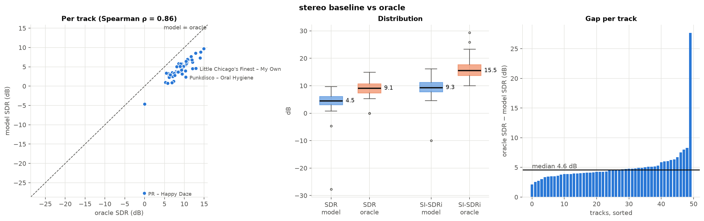
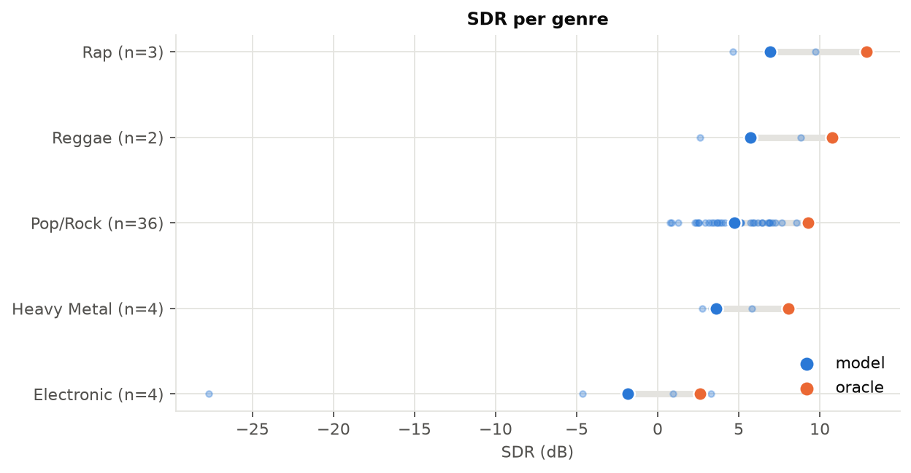

# 01 · Baseline vs oracle

[← back to README](../README.md)

**Question.** How good is my baseline, and how much room is left before the method itself (masking the magnitude, keeping the mixture's phase) becomes the limit?

**Hypothesis.** There's a lot of headroom: the model is far from the best mask it could possibly output.

**Status.** Done. Reference numbers are the **stereo** model under the stereo protocol (the baseline for all later experiments). This analysis was first done on the mono model; those numbers are at the end for the record.

## The model

Based on Jansson et al., *Singing Voice Separation with Deep U-Net Convolutional Networks*, ISMIR 2017. Code: [src/models/unet.py](../src/models/unet.py), [src/module.py](../src/module.py).

- **Input:** magnitude STFT of a ~5.9 s stereo crop (44.1 kHz, `n_fft=2048`, hop 512), shape (batch, 2, 1025, frames). No normalisation.
- **Encoder:** 6 × (Conv 5×5, stride 2, BatchNorm, LeakyReLU 0.2), 16 → 512 channels.
- **Decoder:** 6 transposed convs (5×5, stride 2) with BatchNorm + ReLU, skip connections by concatenation, `Dropout2d(0.5)` on the first 3. The last decoder block outputs raw values (no BN/ReLU), followed by a 1×1 conv and a sigmoid → one mask per channel in (0, 1).
- **Reconstruction:** vocals = mask × |mixture|, combined with the mixture's phase, inverse STFT. Accompaniment = mixture − vocals.
- **Training:** L1 between estimated and true vocal magnitudes, Adam 1e-3, 150 epochs of 500 random crops (batch 8, 63 steps per epoch), early stopping on validation SI-SDR (patience 30), seed 42. 9.8 M parameters.
- **Evaluation:** museval v4 SDR on the 50 test tracks, 1 s windows, median per track then median over tracks; also SI-SDR improvement (SI-SDRi) over the mixture. Full tracks are processed in 6 s windows with 50% overlap and Hann weighting.

### Differences from the paper

| | Jansson et al. 2017 | Here |
|---|---|---|
| Training data | ~20,000 tracks from a private catalogue | MUSDB18 compressed, 84 tracks |
| Sample rate | 8,192 Hz | 44,100 Hz |
| STFT window / hop | 1024 / 768 | 2048 / 512 |
| Magnitude normalisation | scaled to [0, 1] | none |
| Channels | mono | stereo (2 input channels, 2 masks) |
| Number of models | two U-Nets (vocals and instrumental) | one (vocals); accompaniment = mixture − vocals |
| Dropout | 50% | `Dropout2d` (drops whole channels) |
| Evaluation | iKala and MedleyDB, BSS Eval v3 (NSDR, GNSDR) | MUSDB18 test, museval v4, median SDR |

The paper doesn't give a learning rate ("trained using the ADAM optimizer"), so 1e-3 is Adam's default; I tested it in [03](03_lr_schedule.md).

### The head bug

In my first version, the last decoder block (32 → 1 channel) still had BatchNorm + ReLU before the 1×1 conv and sigmoid. So the mask was `sigmoid(w·r + b)` with `r ≥ 0`: it was capped at `sigmoid(b)` and stuck exactly at that value wherever the ReLU output was zero. In the checkpoint trained with this bug, the mask never went above **0.727** and was exactly 0.727 on **46% of time-frequency bins** (measured). Fixed in commit `68ba08f` by removing BN + ReLU from that block.

I don't have a controlled before/after score. The only pre-fix run with a test score stopped at 47 epochs and used an older evaluation pipeline (mono, before several fixes to data loading and evaluation), so it isn't comparable to the current baseline. A clean comparison needs a rerun of the current code with the old head; it's on the to-do list.

## Results

`uv run python -m analysis.baseline_vs_oracle outputs/eval_stereo.json --tag stereo`

The **oracle** is the ideal ratio mask clipped to [0, 1], applied to the mixture with the mixture's phase. It uses exactly the same reconstruction as the model, so it's the best result *this kind of model* can reach, not an absolute ceiling.

| median over 50 test tracks [95% bootstrap CI] | model | oracle |
|---|---|---|
| SDR | **4.50 dB** [3.56, 5.38] | **9.09 dB** [8.25, 10.31] |
| SI-SDRi | 9.31 dB [8.41, 10.65] | 15.49 dB [14.52, 17.04] |

- **The model reaches about half of the oracle** (49% of its median SDR). The paired gap is **4.59 dB** [4.11, 4.79] and the model is below the oracle on all 50 tracks (Wilcoxon p = 2e-15). So there are ~4.6 dB to gain on the mask before the mixture phase becomes the limit. Going beyond that would require handling the phase (complex input or complex mask).
- **Difficulty comes mostly from the track.** The rank correlation between model and oracle SDR is 0.86 (Spearman). Songs that are hard for the model are already hard for the oracle (voice buried in the mix, bins where voice and instruments overlap).
- **The gap is fairly regular** (median 4.6 dB, most tracks between 3 and 6 dB), which looks like a general model loss rather than a few pathological cases. The extreme value (27.7 dB) is *PR - Happy Daze*: its voice is almost inaudible ([00](00_dataset.md)), the oracle SDR is ~0 dB and the model's is −27.7 dB. SDR on a near-silent reference doesn't mean much. The two *PR* tracks are the only ones with an oracle SDR near zero, and they drag the "Electronic" genre down.
- **SDR and SI-SDRi aren't on the same scale.** SI-SDRi is an improvement over the mixture (which starts around −4 dB SI-SDR), while SDR is an absolute score. On top of that, museval SDR is computed on 1 s windows and penalises distortion, not only leakage.

| Genre (n ≥ 2) | n | SDR | oracle | gap |
|---|---|---|---|---|
| Rap | 3 | 6.91 | 12.90 | 5.15 |
| Reggae | 2 | 5.72 | 10.76 | 5.04 |
| Pop/Rock | 36 | 4.73 | 9.28 | 4.25 |
| Heavy Metal | 4 | 3.59 | 8.08 | 3.79 |
| Electronic | 4 | −1.85 | 2.62 | 4.47 |

With 2 to 4 tracks per genre outside Pop/Rock, none of these genre differences is significant.

## Calibration against Open-Unmix

Does my evaluation pipeline reproduce a published number? I ran the pretrained Open-Unmix `umx` (Stöter et al., 2019, JOSS) through `src.evaluate` (same 50 test tracks, official `mixture.wav`, stereo museval v4, same bootstrap) with [`src/evaluate_umx.py`](../src/evaluate_umx.py). The baseline was re-evaluated on the same official mixture.

| model (official mixture, 50 test tracks) | SDR median [95% CI] | paired difference to the baseline |
|---|---|---|
| my baseline (stereo, 150 epochs) | 4.47 dB [3.54, 5.37] | |
| Open-Unmix, `niter 0` (network magnitude and mixture phase, like my U-Net) | 6.06 dB [5.32, 7.30] | +1.44 dB [0.99, 1.70], better on 43/50 |
| Open-Unmix, `niter 1` (published setup, Wiener filter on 4 targets) | **6.43 dB** [5.21, 7.24] | +1.69 dB [1.25, 1.90], better on 43/50 |

- The published value for `umx` is 6.32 dB (median over the 50 tracks). ⚠ I took it from a paper that cites it (Pac-HuBERT, arXiv:2304.02160) and from Papers with Code, not from the Open-Unmix paper. 6.43 is 0.11 dB above it, well inside my CI: the pipeline reproduces the number.
- The baseline is 1.7 dB below Open-Unmix. About 1.4 dB of it remains when Open-Unmix uses my reconstruction, so the gap is mostly in the network and its training, not in the Wiener filter.
- The baseline gives 4.50 dB when the mixture is built as vocals plus accompaniment (the convention of the other pages) and 4.47 dB with the official mixture. All pages keep the first convention.
- Still not comparable with HQ results: this is compressed MUSDB18.

Commands: `uv run python -m src.evaluate CKPT --mixture official --no-oracle -o outputs/eval_stereo_official.json`; `uv run --with openunmix --with torchaudio==2.10.0 python -m src.evaluate_umx --niter {0,1} -o outputs/umx_niter{0,1}.json`.

## For the record: the mono analysis

The same analysis on the original mono model (mono protocol, `outputs/oracle_baseline.json`, figures `baseline_vs_oracle.png` and `baseline_by_genre.png`): SDR 4.70 dB vs oracle 9.21 dB, gap 4.32 dB [4.04, 4.69], Spearman 0.90. Same conclusions. I switched to stereo after [02](02_mono_vs_stereo.md); these numbers aren't used as a reference anywhere else.

## Re-run at 1000 epochs

The controlled rerun of the head bug was done at 1000 epochs with the final recipe ([11](11_final.md)): **−0.01 dB [−0.13, +0.12] on test**, no measurable cost. The trained head has one positive weight per output channel ([[−1.06, +1.48], [−1.07, +1.48]], `analysis.mask_stats`), so the mask is not capped (maximum 1.0, 0 % of the bins at a fixed ceiling). The 0.727 ceiling above was a property of that checkpoint (all its head weights negative), not of the architecture. The fix stays: it removes the failure mode. The final model ([11](11_final.md)): **5.89 dB** on test (official mixture), against 4.47 dB for this page's baseline and 6.43 dB for Open-Unmix.
