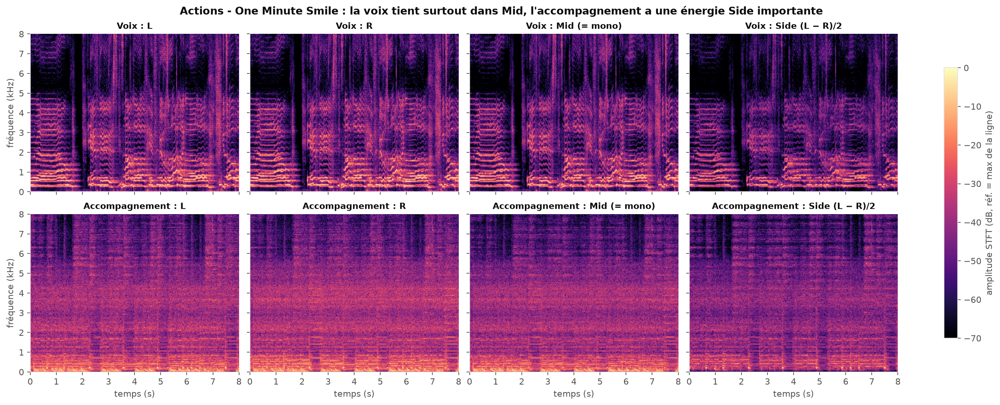
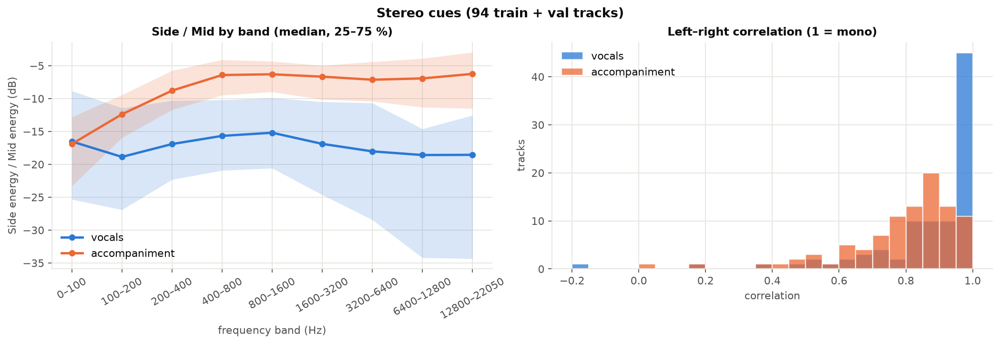
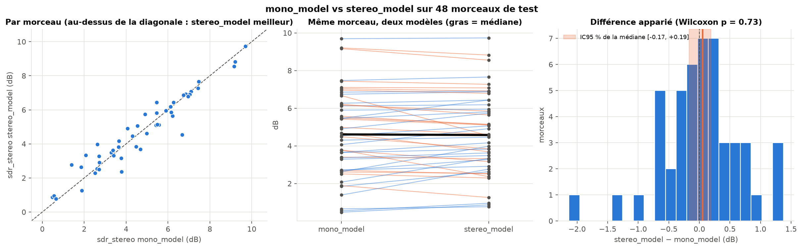

# 02 · Mono → stereo

[← back to README](../README.md)

**Hypothesis.** In most mixes the voice sits in the centre while instruments are spread across the stereo field. Giving the model both channels instead of the mono downmix should let it use that spatial cue and separate better.

**Status.** Done, one seed. Result: no measurable effect. The 3-seed runs (`seeds` group in [deploy/queue.yaml](../deploy/queue.yaml)) are needed before I can really claim "stereo brings nothing".

## Is the cue really there?

`uv run python -m analysis.stereo_analysis`. I split each stem into Mid = (L+R)/2 (exactly the mono signal of the pipeline) and Side = (L−R)/2. A centred source has a Side close to zero.



On the 94 train/val tracks with an audible voice (central 20 s window):



| | vocals | accompaniment |
|---|---|---|
| median L/R correlation | 0.94 | 0.84 |
| energy in Side (median) | 3.0% | 8.4% |
| median Side/Mid | −15.1 dB | −10.4 dB |
| median Side/Mid between 400 Hz and 12.8 kHz | −15 to −19 dB | −6 to −7 dB |
| near-mono tracks (correlation > 0.95) | 48% | 12% |

The premise holds as a trend: the voice is more centred than the accompaniment on 72% of tracks, with **9 to 12 dB less stereo width** between 400 Hz and 12.8 kHz, where most of the voice is. Below 100 Hz both are centred (bass, kick), so stereo can't help there. But it's not a rule: 52% of voices have a correlation below 0.95 (10th percentile at 0.64: stereo reverb, double-tracking), and 12% of accompaniments are near-mono. So the model has a useful but noisy cue to learn, not a "keep the centre" filter to apply.

## Protocol

Same everything except `data.channels` (1 → 2): the stereo model takes 2 magnitude channels and outputs 2 masks. Both models are evaluated on the 50 test tracks under two protocols:
- **mono:** references and estimate downmixed to mono;
- **stereo:** 2 channels; the mono model is applied separately to L and R.

My first comparison put the mono model under the mono protocol against the stereo model under the stereo protocol (4.70 vs 4.50 dB), which looked like a 0.2 dB loss. That was mostly a protocol effect: the same mono model drops from 4.70 to 4.51 dB when scored in stereo.

## Results

| SDR median [95% bootstrap CI] | mono model | stereo model | paired difference stereo − mono |
|---|---|---|---|
| mono protocol | 4.70 dB [3.80, 5.92] | 4.89 dB [3.78, 5.70] | −0.06 dB [−0.35, +0.18], p = 0.44 |
| stereo protocol | 4.51 dB [3.52, 5.47] | 4.50 dB [3.56, 5.38] | +0.04 dB [−0.18, +0.17], p = 0.89 |
| SI-SDRi, stereo protocol | 9.29 dB | 9.31 dB | +0.03 dB [−0.13, +0.31], p = 0.45 |
| oracle SDR (mono / stereo protocol) | 9.21 / 9.09 dB | | |

(The median of paired differences isn't the difference of medians, which is why the mono-protocol row can show a higher median for stereo and a negative paired difference.)



Stereo protocol, SDR, without the 2 *PR* tracks whose voice is almost inaudible. With all 50 tracks the median difference is +0.04 dB, without them +0.05 dB.

## Discussion

- **Stereo brings no measurable gain, and no loss either.** Differences are around 0.05 dB, every interval contains 0, and stereo wins on 26 tracks out of 50: a coin toss.
- **Yet the cue exists.** Two explanations I haven't tested:
  - the mono downmix keeps the Mid, so it already keeps most of the centred voice and drops a larger share of the accompaniment (3% of the voice's energy is in the Side vs 8.4% for the accompaniment). The mono model gets part of the cue for free;
  - the model only receives the magnitudes of L and R, not their phase difference, and has to discover "L ≈ R" through its first convolution (2 → 16 channels). A Mid/Side input, or a single mask applied to the Mid, would give it the cue directly. Possible follow-up.
- **Caveats.** One seed per configuration, and the intervals only measure variability between tracks. *(Update after later experiments: three trainings of the stereo baseline with the same seed differ by up to ±0.15 dB, paired, see [06](06_size_quality.md). So +0.04 dB is well inside training noise; only the 3-seed runs can say whether there's a small effect hiding there.)*

## Decision

I work in stereo from now on. The stereo model is the baseline (SDR 4.50 dB, oracle 9.09 dB, gap 4.59 dB), and `src.evaluate` only evaluates in stereo (2-channel BSSEval SDR, the protocol used in the literature), which also halves evaluation time.

```bash
uv run python -m src.train experiment=stereo
uv run python -m src.train data.channels=1
# both files store the two protocols; `sdr` alone is each model's own protocol, so compare on the same key:
uv run python -m analysis.compare_runs outputs/eval_mono.json outputs/eval_stereo.json --names mono stereo --metric sdr_stereo --exclude "PR -"
```
