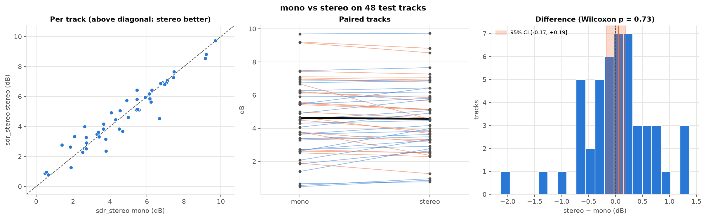

# 02 · Mono → stereo

[← back to README](../README.md)

**In short.** The voice is more centred than the accompaniment, so I expected stereo input to help. It doesn't, measurably: +0.04 dB at 150 epochs, and still inconclusive at 1000 epochs (stereo − mono −0.15 dB [−0.28, +0.14]). I kept stereo, the standard protocol.

## Hypothesis

In most mixes the voice sits in the centre and the instruments are spread out. With both channels instead of the mono downmix, the model could use that cue.

## Is the cue really there?

I split each stem into Mid = (L+R)/2 (the mono signal of the pipeline) and Side = (L−R)/2. A centred source has almost no Side.


| 94 train/val tracks, central 20 s | vocals | accompaniment |
|---|---|---|
| median L/R correlation | 0.94 | 0.84 |
| energy in Side | 3.0 % | 8.4 % |
| Side/Mid between 400 Hz and 12.8 kHz | −15 to −19 dB | −6 to −7 dB |
| near-mono tracks (correlation > 0.95) | 48 % | 12 % |

The cue exists as a trend: the voice is narrower than the accompaniment on 72 % of tracks, by 9 to 12 dB in the voice's band. But it's noisy: half of the voices are not near-mono (stereo reverb, double-tracking).

## Setup

Only `data.channels` changes (1 → 2). I score both models under the stereo protocol; the mono model is applied to L and R separately.

My first comparison was wrong: mono model under the mono protocol (4.70 dB) against stereo model under the stereo protocol (4.50 dB). It looked like a 0.2 dB loss, but the same mono model drops to 4.51 dB when scored in stereo. It was a protocol effect.

## Results (150 epochs)

| SDR median [95 % CI] | mono model | stereo model | stereo − mono, paired |
|---|---|---|---|
| mono protocol | 4.70 dB | 4.89 dB | −0.06 dB [−0.35, +0.18], p = 0.44 |
| stereo protocol | 4.51 dB | 4.50 dB | +0.04 dB [−0.18, +0.17], p = 0.89 |

The mono-protocol row shows a higher median for stereo but a negative paired difference: the median of the differences is not the difference of the medians.



Stereo wins on 26 tracks out of 50: a coin toss.

## After the re-run (1000 epochs)

At 1000 epochs with augmentation ([11](11_final.md)), the mono model could not be judged on validation: its validation crops are downmixed, which alone moves the oracle by +0.93 dB. I decided it on test instead, under the stereo protocol, and wrote that rule down before seeing the numbers. Result: stereo − mono **−0.15 dB [−0.28, +0.14]**, p = 0.41 (1 mono seed against 3 stereo seeds). Still no measurable effect.

## What I conclude

- Stereo input brings neither a gain nor a loss that I can measure.
- Two untested reasons why the cue doesn't help: the mono downmix already keeps the centred voice and drops more accompaniment, and the network sees L and R magnitudes but not their phase difference. A Mid/Side input would give it the cue directly.
- I work in stereo anyway: it's the protocol of the literature and it halves evaluation time.

```bash
uv run python -m src.train experiment=stereo        # data.channels=1 for mono
uv run python -m analysis.stereo_analysis
uv run python -m analysis.compare_runs outputs/eval_mono.json outputs/eval_stereo.json --names mono stereo --metric sdr_stereo --exclude "PR -"
```
