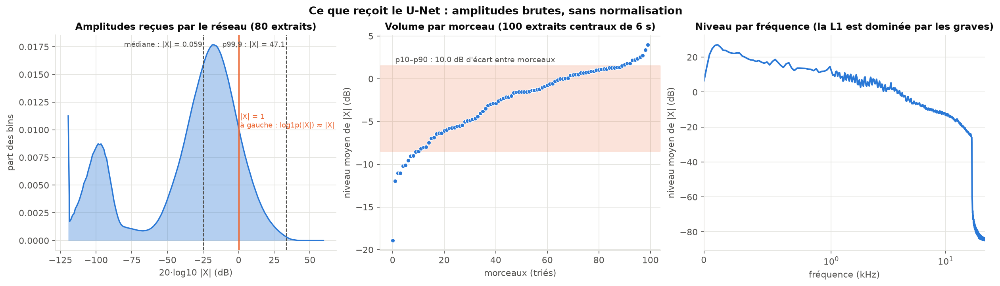
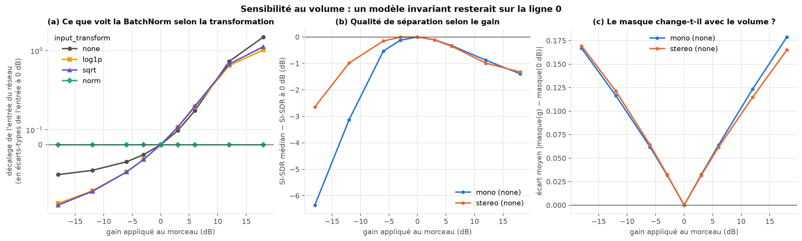
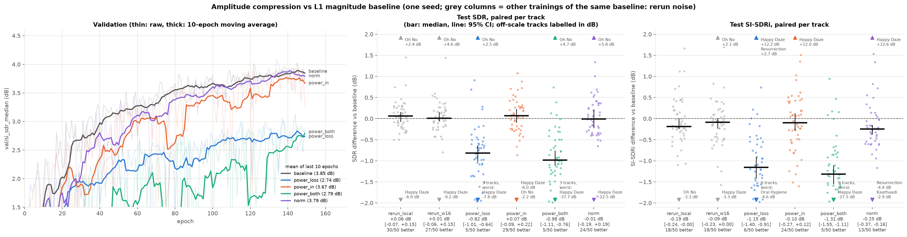

# 05 · Amplitude compression

[← back to README](../README.md)

**Status.** Done, one seed (tag `power-v1`, 4 runs in parallel on the rented GPU). The hypothesis, prediction and protocol below were written before training; results start at [Results](#results).

**Result in one line.** Compressing the magnitude **in the loss** costs about 0.8 to 1 dB of test SDR, the opposite of what I predicted. Compressing only the input (`power_in`) or normalising it (`norm`) changes nothing measurable on SDR. I keep the baseline.

**Baseline.** The stereo baseline with lr 1e-3 constant ([03](03_lr_schedule.md) kept it). The comparison uses the baseline retrained on the server for [04](04_waveform_loss.md) (`loss-v1/baseline_s42`): same machine, same seed, code path unchanged between the two tags. Two other trainings of the same baseline (local, and `w16` from [06](06_size_quality.md)) give the rerun noise.

## Hypothesis

The network receives raw |X|, with no normalisation, and the L1 loss is dominated by loud bins (low frequencies, loud passages). Compressing the magnitude with a power law `|X|^c`, `0 < c < 1`, should give more weight to quiet bins (the voice's high frequencies, sibilants) and reduce the dependence on the track's loudness.

**Prediction** (an estimate): a modest SDR gain (under 0.5 dB) for `power_loss`, to be confirmed on music; no volume invariance for the `power` variants. **If rejected:** the dynamic range between loud and quiet bins doesn't limit this model, or what works on speech doesn't transfer to music.

## What the papers say

| | Braun & Tashev | Wilson et al. |
|---|---|---|
| task | speech enhancement (reverberant, CHiME2), recurrent network, 2.8 M parameters | mono/two-channel speech enhancement (CHiME2 WSJ0), spectrogram mask, low latency |
| where compression is applied | **in the loss**: distance between compressed magnitudes ("compressed MSE", eq. 11-12); the network input is a log power spectrum **with online mean/variance normalisation** | **everywhere**: network input, the representation the mask is applied to, and the loss: "all spectra are power-law compressed (with power 0.3)" |
| exponent | "a commonly used compression exponent is c = 0.3" | 0.3 |
| justification and result | the compressed loss (with MAE) is the best of the distances tested, "which can be attributed to a better match to the signal distributions"; mixed with a complex loss (β = 0.3) it gives the best PESQ; compression helps on real reverberant data | "partially equalizes the importance of quieter sounds relative to loud ones" |

**What they don't show, which limits my conclusions:**
- Both are **speech enhancement, not music separation**. I'm testing whether the idea transfers (a singing voice over a dense multi-instrument mix, compressed MUSDB18, a 2D U-Net with 9.8 M parameters).
- **Neither isolates the effect of compressing the input.** Braun & Tashev compare *losses* (their input is a normalised log spectrum, not a power law), and Wilson et al. apply 0.3 everywhere without an exponent ablation in the text. So the evidence is mostly about the **loss**; compressing the input is my extrapolation from Wilson et al.
- Their metrics are PESQ and SI-SDR on speech, not BSS Eval SDR on music.
- Neither deals with volume invariance: Braun & Tashev use online input normalisation, which is a different idea (see `norm` below).

## What my network receives

`uv run python -m analysis.input_amplitude` (80 validation crops and 100 tracks)



- Median |X| is 0.059 and the 99.9th percentile is 47 (max 263): **58 dB of dynamic range** between the median and the 99.9th percentile. 87% of bins are below 1, where `log1p(|X|) ≈ |X|`. So `log1p`, which I first had in my roadmap, only compresses the 13% loudest bins and isn't what the papers do. I use the power law with `c = 0.3`.
- 22.8% of bins are almost empty (|X| < 1e-3): the AAC encoder's cutoff around 16 kHz.
- **Tracks differ by 10 dB in loudness** between the 10th and 90th percentile (−19 to +4 dB for the mean level of |X|).
- The linear L1 loss is dominated by low frequencies (mean level up to +27 dB, vs about −80 dB above 16 kHz).

## Is the current model sensitive to volume?

Yes. I multiply the mixture by a gain and measure validation SI-SDR (invariant to the output's scale, so only the mask matters) and how much the mask moves compared to 0 dB, on the stereo baseline:



| applied gain | −18 dB | −12 dB | −6 dB | +6 dB | +12 dB | +18 dB |
|---|---|---|---|---|---|---|
| Δ SI-SDR (stereo baseline) | −2.64 | −0.99 | −0.15 | −0.35 | −0.99 | −1.32 |
| mean mask change | 0.17 | 0.12 | 0.06 | 0.06 | 0.12 | 0.17 |

- The mask changes with volume, and **its mean goes up with the gain** (from 0.43 to 0.50 between −6 and +12 dB): the network lets more signal through when the track is louder. The loss is small in the normal range (≤ 0.35 dB for ±6 dB), clear at ±12 dB and beyond, and asymmetric (turning the volume down costs a bit more than turning it up).
- **A power law doesn't make the input volume-invariant** (panel a): the shift of the network input under +6 dB is 0.23 standard deviations without transform, **0.25 with `|X|^0.3`**, 0.26 with `log1p` or `sqrt`. That's the shift BatchNorm can't absorb at inference. Only per-crop normalisation (`norm`) removes it (0.00). So compression is mostly about rebalancing quiet bins, not about volume.

## Runs

One variable changes vs the stereo baseline. Configs in `src/configs/experiment/`, code in `src/utils/input_transform.py` and `src/module.py`.

| config | network input | loss | what it tests | command |
|---|---|---|---|---|
| baseline | \|X\| | L1(\|X̂\|, \|S\|) | reference | `uv run python -m src.train experiment=stereo` |
| power_loss | \|X\| | L1(\|X̂\|^0.3, \|S\|^0.3) | compression in the loss (Braun & Tashev) | `uv run python -m src.train experiment=stereo_power_loss` |
| power_in | \|X\|^0.3 | linear L1 | compression of the input only (extrapolated from Wilson et al.) | `uv run python -m src.train experiment=stereo_power_in` |
| power_both | \|X\|^0.3 | L1(\|X̂\|^0.3, \|S\|^0.3) | both, like Wilson et al. (except the mask, still applied to the linear magnitude) | `uv run python -m src.train experiment=stereo_power_both` |
| norm | \|X\| / mean over the 6 s crop | linear L1 | exact volume invariance | `uv run python -m src.train experiment=stereo_norm` |

Design choices: the mask stays in [0, 1] and is applied to the linear mixture magnitude (`X̂ = mask · |X|`); only the input and the loss distance change. The power law is `(|X| + 1e-8)^c`, because the derivative of `x^c` is infinite at 0 and 22.8% of bins are almost zero. With `c = 1` I get exactly the baseline back (checked). `val/loss` is only comparable between models with the same loss exponent, so early stopping and checkpointing use `val/si_sdr_median`.

Order: **`power_loss` first** (that's where the papers show an effect), then `power_in`, then `power_both` if either helps, and `norm` for volume. In practice all four were trained at the same time on the server. One seed each, so a difference of a few tenths of a dB isn't interpretable on its own.

## Results

```bash
uv run python -m analysis.loss_study --out power_study --title "Amplitude compression vs baseline" \
  --rerun rerun_local=outputs/eval_stereo.json --rerun rerun_w16=outputs/server/size-v1/w16_s42/eval.json \
  --run baseline=outputs/server/loss-v1/baseline_s42 --run power_loss=outputs/server/power-v1/power_loss_s42 \
  --run power_in=outputs/server/power-v1/power_in_s42 --run power_both=outputs/server/power-v1/power_both_s42 \
  --run norm=outputs/server/power-v1/norm_s42
```



**How to read it.** Same layout as [04](04_waveform_loss.md): each dot is a test track, variant minus baseline. The two grey columns are two other trainings of the *same* baseline (same config, same seed): they show how far a difference can go from training noise alone. Their medians stay within ±0.1 dB on SDR.

**Validation** (`val/si_sdr_median`, mean of the last 10 epochs ± std; computed the same way for every model, unlike `val/loss`):

| config | val SI-SDR | Δ vs baseline | epoch-to-epoch noise |
|---|---|---|---|
| baseline (\|X\|, linear L1) | 3.85 ± 0.11 dB | | 0.34 dB |
| power_loss | 2.74 ± 0.21 dB | **−1.11** | 0.60 dB |
| power_in | 3.67 ± 0.24 dB | −0.18 | 0.83 dB |
| power_both | 2.79 ± 0.10 dB | **−1.06** | 2.10 dB |
| norm | 3.79 ± 0.13 dB | −0.05 | 0.67 dB |

**Test** (50 tracks, paired against the server baseline, 95% bootstrap CI of the median difference, Wilcoxon p):

| | test SDR | Δ SDR | better on | Δ SI-SDRi |
|---|---|---|---|---|
| baseline (server) | 4.47 dB | | | |
| *rerun, local* | *4.50 dB* | *+0.06 [−0.07, +0.15]* | *30/50* | *−0.19 [−0.24, −0.00]* |
| *rerun, w16 of [06](06_size_quality.md)* | *4.78 dB* | *+0.01 [−0.06, +0.15]* | *27/50* | *−0.09 [−0.23, +0.00]* |
| power_loss | 3.43 dB | **−0.82 [−1.01, −0.64]**, p = 1e-8 | 5/50 | **−1.15 [−1.40, −0.91]** |
| power_in | 4.52 dB | +0.07 [−0.09, +0.22], p = 0.41 | 29/50 | −0.10 [−0.27, +0.12] |
| power_both | 3.36 dB | **−0.98 [−1.11, −0.76]**, p = 1e-9 | 5/50 | **−1.31 [−1.55, −1.11]** |
| norm | 4.49 dB | −0.01 [−0.19, +0.19], p = 0.85 | 24/50 | −0.25 [−0.37, −0.16], p = 0.005 |

Note the rerun on `w16` scores 4.78 dB median against 4.47 dB for the server baseline, with identical code, config and seed, yet their paired difference is +0.01 dB. A single run's median SDR moves by ~0.3 dB with training noise (the "median track" changes); the paired difference is much more stable. That's why I only compare runs through paired differences.

Training time on the server (4 runs sharing one A800): 24.2 to 24.7 min each, about the same as the baseline (24.4 min). These are estimated from the start time and the last write to `train.log`, because the queue process died before recording the end of training.

## Discussion

- **Compression in the loss hurts, and the test confirms it.** `power_loss` loses 0.82 dB SDR and 1.15 dB SI-SDRi, and is better than the baseline on only 5 tracks out of 50. `power_both` is slightly worse still. That's 5 to 10 times the rerun noise. So the hypothesis is rejected for the loss, which is the part the papers supported (Braun & Tashev). I checked the code path (`VoiceSeparationModule._loss` → `compress`) and the configs resolved on the server; I didn't find a bug.
- **Why? What I measured, and what I only suspect.** On the 16 validation tracks (3 crops each), compressing the target with `c = 0.3` moves **4.90%** of its total weight above 16 kHz, against **0.40%** with the linear L1 (12 times more), and **1.68%** into the near-empty bins (|X| < 1e-3, 22.8% of bins) against **0.00%**. So the compressed loss does spend part of its effort on the band the AAC codec mostly removed. But 5% of the weight probably isn't enough on its own to explain −0.8 dB. A second, untested explanation: `x^0.3` has a very steep slope near 0, so the compressed L1 strongly rewards pushing the mask to exactly 0 wherever the voice is weak. That could make the model over-suppress and create holes in the voice. Measuring the mask distribution of the trained models (share of bins below 0.01, compared to the baseline) would test it, but it needs the checkpoints.
- **The speech results don't transfer here, at least at c = 0.3.** Braun & Tashev and Wilson et al. work on speech enhancement at 16 kHz with other networks and other metrics (PESQ). Their target is speech in noise, where quiet bins are mostly noise to remove. Here quiet bins are a mix of codec-cut bands and quiet parts of the voice. I only tried one exponent, so "c = 0.3 in the loss hurts this model" is all I can conclude, not "compression never helps".
- **Compressing the input alone is neutral** (`power_in`: +0.07 dB SDR on test, −0.18 dB on validation, both within the noise). Its validation curve is much noisier (0.83 dB from epoch to epoch, vs 0.34 for the baseline), with a big collapse around epoch 75.
- **Per-crop normalisation (`norm`) is neutral on SDR** (−0.01 dB). On SI-SDRi it's 0.25 dB lower and better on only 13 tracks out of 50, which is just beyond the rerun noise on that metric (−0.19 dB for the local rerun): a small cost, not a clear one. Its mean SDR difference (−0.32 dB) comes from *PR - Happy Daze* (−22.5 dB), the near-silent track that already moves by 7 to 9 dB between baseline reruns. Quality was never the point of `norm` anyway: its job is volume robustness (the baseline loses 2.6 dB at −18 dB of input gain), and test tracks are at their original level, so that can't show here. Rerunning the gain-sensitivity test on `norm` needs its checkpoint.
- **All four variants make validation noisier** (0.60 to 2.10 dB epoch-to-epoch vs 0.34 dB). `power_both` in particular drops below 1.5 dB several times before epoch 130. I don't know why; BatchNorm statistics on a rescaled input are one candidate.

## Decision

- **I drop compression in the loss** (`power_loss`, `power_both`): clearly worse on validation and test.
- **`power_in` brings nothing**, so I don't adopt it.
- **`norm` stays a candidate for volume robustness only.** It costs nothing on SDR and maybe a little on SI-SDRi. I'll adopt it only if the gain-sensitivity test shows it removes the baseline's 1 to 2.6 dB loss at ±12-18 dB.

## What's left

- Bring back the `norm` and `power_loss` checkpoints (`deploy/fetch_results.sh power-v1 --ckpt norm_s42 --ckpt power_loss_s42`) for the gain-sensitivity test (`analysis.input_amplitude`) and the mask-distribution check.

## References

- S. Braun, I. Tashev, *A consolidated view of loss functions for supervised deep learning-based speech enhancement*, [arXiv:2009.12286](https://arxiv.org/abs/2009.12286), 2020. Read in full. The arXiv page doesn't give a venue; to check before citing elsewhere.
- K. Wilson, M. Chinen, J. Thorpe, B. Patton, J. Hershey, R. F. Saurous, J. Skoglund, R. F. Lyon, *Exploring Tradeoffs in Models for Low-latency Speech Enhancement*, [arXiv:1811.07030](https://arxiv.org/abs/1811.07030), 2018. Read in full. Same remark about the venue.

## Re-run at 1000 epochs

Re-run at 1000 epochs with data augmentation ([11](11_final.md)): `|X|^0.3` in the loss costs **−1.00 dB [−1.21, −0.90]** on test (1 seed, better on 1/50 tracks), −1.28 dB on validation. The gap did not close with training, so it was not a convergence artefact. The "mask pushed to zero" explanation is **rejected**: on validation, the mask is below 0.05 on 6.1 % of the weak-voice bins against 14.7 % for the reference (`analysis.mask_stats`). The weighting of the codec-emptied band above 16 kHz remains the untested candidate. `power_in` and `norm` were not re-run.
