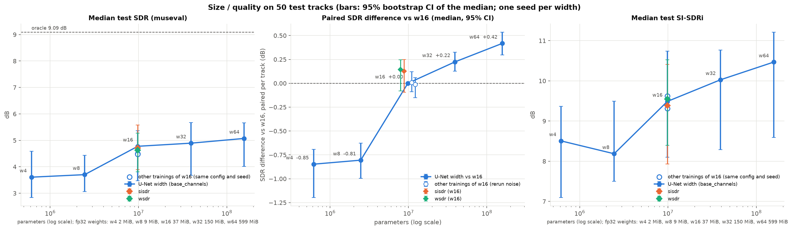

# 06 · Size/quality curve

[← back to README](../README.md)

**Status.** Done, one seed per width (tag `size-v1`, 5 runs in parallel on the rented GPU). The hypothesis, prediction, protocol and limits below were written before training; results start at [Results](#results).

**Result in one line.** Width matters more than anything else I've tried: w32 (39 M parameters, fits in 4 GB) beats the baseline by **+0.22 dB** paired SDR, above the rerun noise, while the best loss tricks give +0.13 dB, within it. Below the baseline, quality drops by about 0.8 dB at w8 and w4.

**Why.** The project's question is about a model under 4 GB of VRAM, so I need to know how quality scales with size. This curve is also the background for the other experiments: an improvement (loss, compression) only means something if its gain beats what simply using a bigger model would give. It doesn't depend on [04](04_waveform_loss.md) or [05](05_amplitude_compression.md) and can run at the same time on the server.

## Hypothesis

With a fixed training budget (150 epochs, same data, same LR), a wider U-Net separates the voice better: test SDR goes up with the number of parameters, with diminishing returns. Intuition: capacity limits what the mask can represent (singing voice and instruments overlap in frequency), until something else caps it (data, mixture phase).

**Prediction** (an estimate): increasing curve with diminishing returns; w4 clearly below the baseline (around 1 dB), w32 a few tenths of a dB above w16.
**If rejected** (w32 and w64 don't beat w16 beyond the noise): capacity isn't the limit at this budget (under-training, data, or the mixture phase: oracle at 9.09 dB vs 4.50 dB). The baseline's size would then be enough and the gains would have to come from elsewhere, which is a useful answer for the 4 GB constraint. If w8 or w4 match w16, the baseline is oversized and 4 GB isn't the binding constraint.

## Setup

Only the **width** changes: `model.base_channels` (`src/models/unet.py`, `UNet`), the number of channels of the first layer, which doubles at each level (16, 32, …, 512 for the baseline). Depth 6, STFT, crop, data, loss, LR, seed and number of epochs are identical. The number of parameters is roughly proportional to `base_channels²`, so **each doubling of width multiplies the parameters by 4**.

I don't vary depth: `compute_crop_length` ties it to the crop length (`2**depth` frames), so changing depth would also change the data seen and the receptive field, and I couldn't tell which variable is acting.

Widths 4, 8, 16, 32, 64: a factor of 2 is the natural step (×4 in parameters), and 5 points cover ~2.4 orders of magnitude, enough to see a slope and maybe a plateau on a log scale. These values are chosen for coverage, not sourced.

| config | `base_channels` | parameters | fp32 weights | peak VRAM, 1 step, batch 8 stereo | s/step (GTX 1650) | command |
|---|---|---|---|---|---|---|
| w4 | 4 | 0.62 M | 2.3 MiB | 0.50 GiB | 0.074 | `uv run python -m src.train experiment=stereo_w4` |
| w8 | 8 | 2.46 M | 9.4 MiB | 0.74 GiB | 0.121 | `uv run python -m src.train experiment=stereo_w8` |
| **w16 (baseline)** | 16 | 9.82 M | 37.5 MiB | 1.28 GiB | 0.270 | `uv run python -m src.train experiment=stereo` |
| w32 | 32 | 39.28 M | 149.9 MiB | 2.63 GiB | 0.773 | `uv run python -m src.train experiment=stereo_w32` |
| w64 | 64 | 157.11 M | 599.3 MiB | **6.02 GiB** (> 4 GB) | not meaningful (19 s/step: GPU memory spills into shared memory) | `uv run python -m src.train experiment=stereo_w64` |

How I measured: GTX 1650 4 GB, Adam, fp32, random input (8, 2, 1025, 512), 5 steps after 3 warm-up steps, excluding data loading and validation, so it's an order of magnitude rather than the VRAM of a full training. The baseline gives 1.28 GiB here vs 1.37 GiB in real training ([04](04_waveform_loss.md)), about 0.1 GiB apart. So w32 fits in 4 GB. **w64 doesn't** (6.02 GiB peak; weights + gradients + Adam states = 4 × 599 MiB ≈ 2.3 GiB, the rest is activations). It's only trained on the rented GPU, to see whether the curve keeps rising beyond the budget. It's **not** a candidate for the project.

## Decision protocol

- Metric: museval SDR median over the 50 test tracks (no model selection here, so no leakage risk), with the bootstrap 95% CI of the median, and the paired per-track median difference **against w16** (95% CI and Wilcoxon, like `analysis.compare_runs`). The CI of the median alone is wide (about ±1 dB, tracks are very heterogeneous), while the paired difference is much tighter. SI-SDRi is reported too.
- Size: number of parameters and fp32 weight size. int8 (weights / 4) will come later, shifting each point by a factor of 4 in size. *(Done for the w16 baseline in [08](08_int8_quantization.md): same quality, 3.98× smaller; the other widths aren't quantized yet.)*
- Slope: linear fit of SDR against log2(width), i.e. dB gained per doubling of width.
- One seed per point: a difference of a few tenths of a dB between neighbouring points can't be interpreted alone. The overall slope over 5 points is more reliable than any single gap.

## Known limits, stated before running

- **Fixed budget in epochs, not convergence.** The baseline is already under-trained at 150 epochs ([03](03_lr_schedule.md)). If w32 and w64 are even more under-trained, the curve **underestimates** their gain. A small model, on the other hand, saturates sooner. Early stopping (patience 30) stays on, as for the baseline.
- **The best LR probably depends on width** (not tested): 1e-3 was checked for w16 and may be too high for w64. Not re-tuning per size favours w16.
- **Little data:** 84 training tracks. A big model may overfit; dropout (0.5 on the first 3 decoders) is the same at every width.
- I haven't found (and read in full) a scaling-law study for music source separation, so this hypothesis is mine, not a replication.

## Results

```bash
uv run python -m analysis.size_quality \
    --run 4=outputs/server/size-v1/w4_s42/eval.json   --run 8=outputs/server/size-v1/w8_s42/eval.json \
    --run 16=outputs/server/size-v1/w16_s42/eval.json --run 32=outputs/server/size-v1/w32_s42/eval.json \
    --run 64=outputs/server/size-v1/w64_s42/eval.json \
    --rerun local=outputs/eval_stereo.json --rerun loss-v1=outputs/server/loss-v1/baseline_s42/eval.json \
    --variant sisdr=outputs/server/loss-v1/sisdr_s42/eval.json --variant wsdr=outputs/server/loss-v1/wsdr_s42/eval.json
```



**The middle panel is the one to read.** The left panel shows each run's median SDR with its CI over tracks (about ±1 dB, so everything overlaps). The middle one shows the paired per-track difference against w16, which is much tighter. The hollow points are two other trainings of w16 with the same config and seed (the local baseline and the `loss-v1` one): their paired differences (+0.01 and −0.01 dB, CIs within ±0.15 dB) show what training noise alone does. The diamonds are the two best loss variants from [04](04_waveform_loss.md), also at w16.

| width | parameters | fp32 weights | test SDR median | Δ SDR vs w16, paired [95% CI] | better on | test SI-SDRi | epochs run (best) |
|---|---|---|---|---|---|---|---|
| w4 | 0.62 M | 2.3 MiB | 3.61 dB | **−0.85 [−1.20, −0.69]** | 4/50 | 8.51 dB | 150 (121) |
| w8 | 2.46 M | 9.4 MiB | 3.70 dB | **−0.81 [−1.00, −0.63]** | 3/50 | 8.19 dB | **122** (91), early stop |
| **w16 (baseline)** | 9.82 M | 37.5 MiB | 4.78 dB | | | 9.49 dB | 150 (147) |
| w32 | 39.28 M | 149.9 MiB | 4.89 dB | **+0.22 [+0.13, +0.32]**, p = 0.002 | 35/50 | 10.03 dB | **138** (107), early stop |
| w64 (> 4 GB) | 157.11 M | 599.3 MiB | 5.07 dB | **+0.42 [+0.30, +0.54]**, p = 1e-8 | 44/50 | 10.47 dB | 150 (146) |
| *w16, local rerun* | | | *4.50 dB* | *+0.01 [−0.09, +0.12]* | *26/50* | *9.31 dB* | |
| *w16, `loss-v1` rerun* | | | *4.47 dB* | *−0.01 [−0.15, +0.06]* | *23/50* | *9.62 dB* | |
| sisdr (w16) | | | 4.71 dB | +0.13 [−0.09, +0.25] | 31/50 | 9.39 dB | |
| wsdr (w16) | | | 4.63 dB | +0.14 [−0.08, +0.25] | 28/50 | 9.55 dB | |

Validation (`val/si_sdr_median`, mean of the last 10 epochs): w4 2.67, w8 3.17, w16 3.95, w32 4.02, w64 4.41 dB. Training time on one shared A800 (5 runs in parallel): 27, 25, 29, 33 and 47 min.

## Discussion

- **Bigger is better, and the gain above w16 is real.** w32 is better than w16 on 35 tracks out of 50 (+0.22 dB), w64 on 44 (+0.42 dB). Both CIs are clear of the rerun noise, which stays within about ±0.15 dB. Above w16 the gain is roughly constant per doubling (+0.22 then +0.20 dB). So I don't see the diminishing returns I predicted, at least up to 157 M parameters.
- **It's the first real gain of the project, and it's a boring one.** Doubling the width beats every trick I tried so far: SI-SDR and wSDR losses give +0.13/+0.14 dB against this w16, with CIs that include 0. Within the 4 GB budget, **w32 is the best model I have**: 2.63 GiB peak VRAM measured on the GTX 1650, but 2.9 times slower per step (0.77 vs 0.27 s/step).
- **Below w16 there is a cliff, not a slope.** w4 and w8 are about the same (−0.85 and −0.81 dB; on SI-SDRi w4 is even slightly ahead), then w16 jumps by 0.8 dB. A fit of SDR against log2(width) gives +0.41 dB per doubling, but that average hides the shape, so I don't use it. I don't know why the jump is between 2.5 M and 10 M parameters. One thing to keep in mind is that w8 was cut by early stopping (next point).
- **Early stopping cut two of the runs.** w8 stopped at epoch 122 (best epoch 91) and w32 at epoch 138 (best 107). w8 had really plateaued (3.12 dB over epochs 90-99, 3.17 over its last 10). w32 had not (3.88 → 4.02 dB): its validation is very noisy (1.11 dB from epoch to epoch), so early stopping latched onto a lucky peak at epoch 107 and waited 30 epochs for it to be beaten. So **w32's gain is probably underestimated**, which only strengthens the conclusion. I listed this risk before running; I should have disabled early stopping for this experiment.
- **Rerun noise, now measured three times.** The three trainings of w16 (same code, config and seed) have medians of 4.47, 4.50 and 4.78 dB: a single run's median moves by up to 0.3 dB. But their paired differences are within ±0.15 dB. That's GPU non-determinism only, not seed variability (which should be at least as large), but it's the best yardstick I have until the 3-seed runs.
- **Still under-trained, except w8.** Between epochs 90-99 and the last 10 epochs, validation SI-SDR still gains 0.17 (w4), 0.30 (w16), 0.14 (w32) and 0.33 dB (w64); only w8 is flat (+0.05). The big models don't plateau sooner, so the comparison is "at equal epoch budget", not "at convergence", as planned.
- **Against the prediction.** I predicted w4 about 1 dB below the baseline (measured −0.85 dB) and w32 a few tenths above (+0.22 dB): both right. I also predicted diminishing returns, which I don't see above w16.

## Decision

- **w16 stays the reference for the other experiments**, so that everything remains comparable. But the size curve becomes the background for every later result: a trick is only worth adding if it beats the +0.22 dB that w32 gives for free.
- **w32 is the candidate final model under the 4 GB constraint.** Before adopting it: rerun it with early stopping off and with 3 seeds.
- w64 is out of budget (6.02 GiB peak); it only shows the curve keeps rising.

## Running it on the server

`size` group of [deploy/queue.yaml](../deploy/queue.yaml) (w4, w8, w16, w32, w64), seed 42. `w16` is the baseline retrained on the server so the whole curve comes from one machine.

```bash
# server
.venv/bin/python deploy/run_queue.py --tag size-v1 --group size --parallel 5
# PC
deploy/fetch_results.sh size-v1 --wait
```
