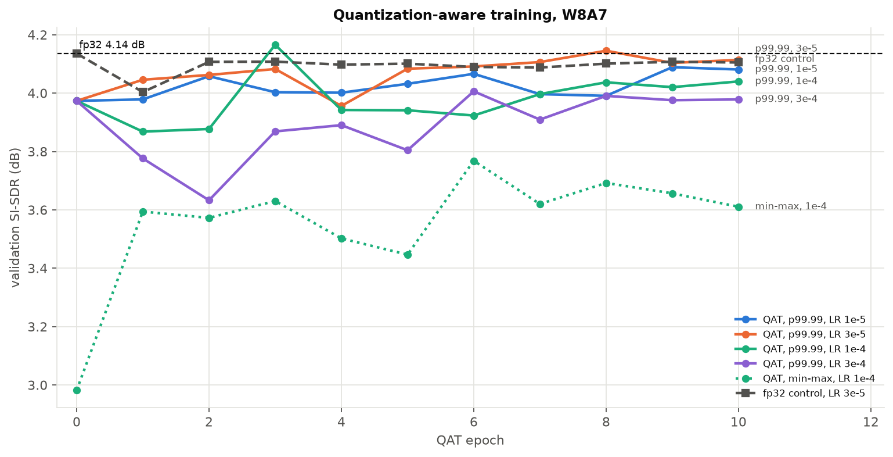

# 08 · int8 quantization

[← back to README](../README.md)

**In short.** On the 150-epoch w16 baseline, int8 is almost free in quality if the activation ranges are clipped: post-training quantization costs −0.02 dB, and the real int8 model scores **4.49 dB against 4.50 dB**. The model is **4× smaller** (39.3 → 9.9 MB), but **2.3× slower** on my CPU, because int8 transposed convolutions are slow. Not re-run on the final w32 model.

## Question

How much quality does int8 cost, can quantization-aware training (QAT) recover it, and is int8 faster on my CPU?

I followed two guides: Nagel et al. 2021 (arXiv:2106.08295, § 2 to 4) and Krishnamoorthi 2018 (arXiv:1806.08342). Both test image models, not audio or masks.

## Setup

- Only the U-Net is quantized; the STFT and the mask stay in floating point.
- Two code paths with the same quantizer positions ([src/quantization.py](../src/quantization.py)): a **simulation** with fake quantizers on the GPU, for the ablations and QAT, and the **real int8** kernels of PyTorch (fbgemm) on the CPU, for size and speed. They agree within 0.07 dB.
- Following Nagel: BatchNorm folded into the convolutions, symmetric per-channel weights, asymmetric per-tensor activations, ranges calibrated on 64 training crops.
- Activations use 7 bits (PyTorch's `reduce_range`, a precaution for CPUs without VNNI). It turned out unnecessary on this CPU.
- Ablations are scored on the 240 validation crops (fp32: 4.136 dB SI-SDR), the final numbers on the 50 test tracks.

**Predictions:** int8 weights almost free, 4 bits harmful; activations with min-max ranges harmful, mostly because of the input (58 dB of dynamic range, [05](05_amplitude_compression.md)); QAT recovers most of the gap.

## Results


| post-training quantization (simulation) | Δ val SI-SDR |
|---|---|
| weights only, int8 | −0.03 dB |
| weights only, 6 bits | −0.04 dB |
| weights only, 4 bits | **−1.00 dB** |
| weights + activations, min-max ranges | **−1.15 dB** |
| weights + activations, min-max, input kept in fp32 | −1.12 dB |
| weights + activations, ranges clipped at the 99.99th percentile | **−0.16 dB** |
| weights + activations, MSE ranges | −0.48 dB |

- **Weights are free; activations are the whole problem.** My guess about the input was wrong: keeping it in fp32 changes nothing.
- **The damage is in the first two encoder layers.** Quantized alone, `enc0.conv` costs −0.94 dB and `enc1.conv` −0.60 dB; almost every other quantizer costs less than 0.1 dB. Outliers stretch their min-max range (for `enc0.conv`, the maximum is 5.3× the 99.99th percentile), so their quantization step is several times larger than in most deeper layers (1.1 to 1.6, against 0.2 to 0.6). Clipping at the percentile fixes it. Step size alone doesn't explain the whole ranking; how errors propagate matters too (⚠ not separated).
- MSE ranges do worse than the percentile here and move by up to 0.2 dB with the calibration sample. I didn't find out why.

### QAT

10 epochs starting from the percentile model, cosine rate to 0, last epoch kept. Best rate 3e-5: the validation gap goes from −0.16 to **−0.02 dB**.



**The control changed the conclusion.** Fine-tuning the same model in fp32 with the same schedule, without quantization, ends at −0.03 dB on validation and gains +0.08 dB on test. So QAT's apparent gain on test (+0.05 dB) comes from the extra epochs, not from quantization. Against that control, the real int8 model is −0.07 dB [−0.12, −0.03].

### Test set (50 tracks)

| model | SDR | Δ vs fp32, paired [95 % CI] | better on |
|---|---|---|---|
| fp32 baseline | 4.50 | | |
| PTQ, min-max (simulation) | 3.72 | **−0.63 [−0.75, −0.48]** | 4/50 |
| PTQ, 99.99th percentile (simulation) | 4.40 | −0.02 [−0.07, +0.01] | 21/50 |
| **QAT, real int8 on CPU** | **4.49** | −0.00 [−0.07, +0.07] | 24/50 |
| *control: fp32 fine-tuned, no quantization* | *4.70* | *+0.08 [+0.03, +0.16]* | *33/50* |

### Size and speed (real int8, Intel i5-10300H)

| | fp32 | int8 |
|---|---|---|
| weights on disk | 39.34 MB | **9.87 MB** (3.98× smaller) |
| one 5.93 s excerpt, 1 thread | 251–258 ms | 585–611 ms (**2.3× slower**) |
| one 5.93 s excerpt, 4 threads | 116–131 ms | 266–270 ms |

Per layer, the int8 transposed convolutions are **4× slower** than in fp32, and the int8 convolutions are no faster (1.00×). The last decoder alone takes 359 ms in int8. Krishnamoorthi reports 2–3× speed-ups on phone CPUs for networks without transposed convolutions; my result doesn't contradict that. A fast int8 decoder would need a different upsampling layer: a different model.

## What I conclude

- int8 makes this model 4× smaller at the same quality, if the activation ranges are clipped. QAT isn't needed.
- On this CPU it helps size, not speed.
- Limits: one checkpoint and one seed; only W8A8 has real kernels; the numbers depend on this CPU and PyTorch 2.10. Not tested: w32, learnable ranges, mixed precision.

```bash
CK=outputs/VoiceSeparation/fgvzjxua/checkpoints/baseline-stereo.ckpt
uv run python -m src.quantize sweep $CK -o outputs/quant/sweep_baseline.json
uv run python -m src.quantize sensitivity $CK --max-batches 15 -o outputs/quant/sensitivity_baseline.json
uv run python -m src.quantize qat $CK --act-range percentile --epochs 10 --lr 3e-5 --cosine --tag p99_lr3e-5_cos -o outputs/quant/baseline.qat_p99_lr3e-5_cos.pt
uv run python -m src.quantize evaluate $CK --qat outputs/quant/baseline.qat_p99_lr3e-5_cos.pt --real -w 2 -o outputs/quant/test_qat_real.json
uv run python -m src.quantize export $CK --qat outputs/quant/baseline.qat_p99_lr3e-5_cos.pt --cpu
uv run python -m src.quantize profile $CK --qat outputs/quant/baseline.qat_p99_lr3e-5_cos.pt -o outputs/quant/profile_qat_lr3e-5.json
```

## References

- M. Nagel, M. Fournarakis, R. A. Amjad, Y. Bondarenko, M. van Baalen, T. Blankevoort, *A White Paper on Neural Network Quantization*, [arXiv:2106.08295](https://arxiv.org/abs/2106.08295), 2021.
- R. Krishnamoorthi, *Quantizing deep convolutional networks for efficient inference: A whitepaper*, [arXiv:1806.08342](https://arxiv.org/abs/1806.08342), 2018.
