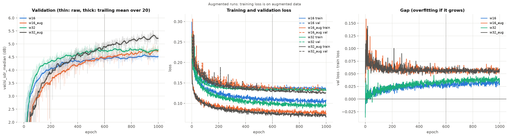

# 09 · Convergence probe (fixing the training budget B)

[← back to README](../README.md)

**Status.** Running on the rented GPU (tag `probe-v1`, 4 runs in parallel). **This page was written while the probe was running, not before it.** The tag `probe-v1` points at commit `4e2ba94` (16 Oct 2026, 14:17 +08), which contains no prediction page. What is fixed in git before any curve was read: the rule that gives B, as constants of [`analysis/convergence.py`](../analysis/convergence.py) (commit `c9ccd33`, 16 Oct 2026, 15:16 +08), and the experiment configs (`probe_*`, commit `52d58fa`). I had not opened any probe curve when I wrote the predictions below. I can't prove that from git, so read them accordingly.

**Result in one line.** Not available yet.

## Why

All the runs of experiments 02 to 07 stop at 150 epochs (9,450 steps) while validation is still rising, so their comparisons measure how fast a model converges as much as where it ends. Early stopping makes it worse: the epoch-to-epoch noise of the validation score (0.32 dB for w16, 1.11 dB for w32, [03](03_lr_schedule.md) and [06](06_size_quality.md)) is larger than the progress over its patience window (about 0.18 dB over 30 epochs), so a run stops on a lucky peak. Before re-running anything I need one budget B, the same for every run, chosen from where a long run actually flattens.

## Hypothesis

1. **Without augmentation**, validation flattens and then goes down: with 84 training tracks the model starts to overfit. The gap between validation loss and training loss grows.
2. **With augmentation** (stem remix, gain, channel swap, [`MUSDBTrainDataset`](../src/data/dataset.py)), the curve keeps rising for longer.
3. If both hold, augmentation could not have helped at 150 epochs, because the overfitting regime had not been reached. That would change how the 150-epoch results must be read.

**If rejected** (the plain runs keep rising to 1,000 epochs, or the augmented ones flatten as early as the plain ones): the 150-epoch comparisons were limited by something else than overfitting, and B is set by the rule below anyway. A result that contradicts (1) is as informative as one that confirms it.

Planning assumption, not a prediction: the cost estimates of the next phases use B ≈ 600 epochs.

## Setup

| run | config | epochs |
|---|---|---|
| P1 | `probe_w16`: w16, no augmentation, LR 1e-3 constant | 1,000 |
| P2 | `probe_w16_aug`: w16, augmentation | 1,000 |
| P3 | `probe_w32`: w32, no augmentation | 1,000 |
| P4 | `probe_w32_aug`: w32, augmentation | 1,000 |

Seed 42, early stopping off, validation on the 16 validation tracks, last checkpoint kept. P1 and P2 save a weights-only checkpoint every 100 epochs. w32 is in the probe because B must hold for the largest model compared under 4 GB. One seed only: B is a planning value, not a result to be compared between configurations.

## Decision protocol (frozen in `analysis/convergence.py`)

- Metric: `val/si_sdr_median`, smoothed by a trailing mean over 20 epochs.
- Gain: smoothed value 100 epochs later minus smoothed value now. B is the first epoch at which this gain falls below **0.05 dB per 100 epochs**, rounded up to the next multiple of 100 (so it lands on a periodic checkpoint). 0.05 dB is a third of the ±0.15 dB between reruns of the same baseline ([06](06_size_quality.md)): below it, the remaining gain can't be told from noise.
- B of the study = the largest B of P2 and P4 (augmentation is the recipe I expect to keep, and w32 is the largest model). Curve still rising at epoch 1,000: B = 1,000.
- **First crossing, not "stays below until the end".** I chose this before seeing probe data, from the noise measured on the 150-epoch baseline (0.18 dB standard deviation of the epoch-to-epoch differences). With that noise, the gain of a 20-epoch mean fluctuates by about 0.04 dB, close to the 0.05 dB threshold: in a simulation (4(1 − e^(−e/100)) plus noise) the "stays below" variant returned B of 800 to 900 whatever the curve, the first crossing returned 400 (500 without noise). The first crossing can be early by up to a hundred epochs; the script prints the largest gain after the crossing as a check.
- Overfitting check: `python -m analysis.convergence plot` draws validation, training and validation loss, and their gap. The training loss of the augmented runs is measured on augmented data, so gaps are compared within a run, not between augmented and plain runs.

## Results

Probe finished on 16 Oct 2026 (tag `probe-v1`, 4 runs in parallel; training time 160 min per w16 run, 196 min per w32 run). One seed, validation only: no test number has been computed.

```bash
uv run python -m analysis.convergence budget --run w16_aug=outputs/server/probe-v1/probe_w16_aug_s42 --run w32_aug=outputs/server/probe-v1/probe_w32_aug_s42
uv run python -m analysis.convergence plot --budget 1000 --run w16=... --run w16_aug=... --run w32=... --run w32_aug=...
```



**What the frozen rule gives** (`figures/convergence_budget.json`):

| run | first crossing below 0.05 dB / 100 epochs | B of the run | largest smoothed gain after the crossing |
|---|---|---|---|
| w16 | epoch 294 | 300 | +0.15 dB / 100 ep |
| **w16_aug** | epoch 567 | **600** | **+0.18 dB / 100 ep** |
| w32 | epoch 315 | 400 | +0.20 dB / 100 ep |
| **w32_aug** | epoch 389 | 400 | **+0.29 dB / 100 ep** |

The rule gives **B = 600** (the largest of w16_aug and w32_aug).

**Validation along the runs** (`val/si_sdr_median`, mean ± std of the 10 epochs ending at the given epoch):

| epoch | 150 | 300 | 400 | 600 | 800 | 1000 |
|---|---|---|---|---|---|---|
| w16 | 3.90 ± 0.12 | 4.23 ± 0.14 | 4.33 ± 0.13 | 4.40 ± 0.06 | 4.50 ± 0.06 | 4.50 ± 0.07 |
| w16_aug | 3.47 ± 0.10 | 3.90 ± 0.23 | 4.17 ± 0.17 | 4.42 ± 0.15 | 4.70 ± 0.12 | 4.74 ± 0.09 |
| w32 | 4.25 ± 0.17 | 4.52 ± 0.11 | 4.67 ± 0.11 | 4.76 ± 0.09 | 4.77 ± 0.07 | 4.76 ± 0.10 |
| w32_aug | 3.54 ± 0.16 | 4.26 ± 0.15 | 4.62 ± 0.14 | 4.89 ± 0.14 | 5.13 ± 0.10 | 5.23 ± 0.07 |

Gap between validation and training loss (mean of the last 10 epochs) at epochs 150 / 600 / 1000: w16 0.018 / 0.028 / 0.032, w32 0.020 / 0.033 / 0.037, w16_aug 0.061 / 0.056 / 0.056, w32_aug 0.061 / 0.055 / 0.056 (the augmented ones are measured on augmented training data: compare within a run only).

### Decision: B = 1000, against the rule

The check written above ("the script prints the largest gain after the crossing as a check") fails: after their first crossing, the two augmented curves rise again by up to 0.18 and 0.29 dB per 100 epochs, four to six times the tolerance. Between epochs 600 and 1000 they still gain +0.32 dB (w16_aug) and +0.34 dB (w32_aug), while the plain runs are flat (+0.10 and 0.00). The first crossing was a noise dip, the failure mode this page already named ("can be early by up to a hundred epochs"), but here by 400 epochs.

B = 600 would compare the recipes on augmented models that are still about 0.3 dB short of their plateau: at epoch 600, w16_aug and w16 are equal (4.42 against 4.40), at epoch 1000 w16_aug is ahead by 0.24 dB. Phase 2 would then conclude that augmentation does nothing for the very reason this re-run exists (comparing models that have not finished training). **I take B = 1000**, the length of the probe, which is also what this page prescribes for curves still rising at the end. This is a deviation from the frozen rule, decided after seeing the curves; the numbers above are what it rests on. Cost: phase 2 grows from about 4 h to about 6.7 h of machine time.

### Hypotheses

1. **Without augmentation, validation flattens then goes down: half confirmed.** It flattens (w32 around epoch 500, w16 around epoch 700) but does not go down up to epoch 1000. The loss gap grows a little (w16 0.018 → 0.032), so there is mild overfitting on the loss, none on the SI-SDR.
2. **With augmentation the curve rises for longer: confirmed.** +0.32 / +0.34 dB between epochs 600 and 1000, against +0.10 / 0.00 without.
3. **Augmentation could not help at 150 epochs: confirmed, and stronger than stated.** At epoch 150 it *costs* 0.43 dB (w16) and 0.71 dB (w32); at epoch 1000 it gains 0.24 dB and 0.47 dB. The ranking flips with the budget, which is what the 150-epoch results of 02 to 07 could not see.

Also visible, to be confirmed with seeds: the 150-epoch baseline is far from its plateau (w16: 3.90 → 4.50 dB), and the gain of w32 over w16 shrinks without augmentation (+0.35 → +0.26 dB) but grows with it (+0.07 → +0.49 dB), the H2 of [06](06_size_quality.md) and of the phase-3 plan.

One seed per curve: the within-run standard deviation of the 10-epoch window is about 0.1 dB, the seed-to-seed spread is not known yet (phase 2 measures it).

## What's left

- Phase 2 reads the seed-42 constant-LR cells from these runs at epoch B (`analysis.convergence at --epoch B`), so only seeds 43 and 44 are trained for them.
- The probe's last checkpoints stay on the server for the final test (phase 5).
