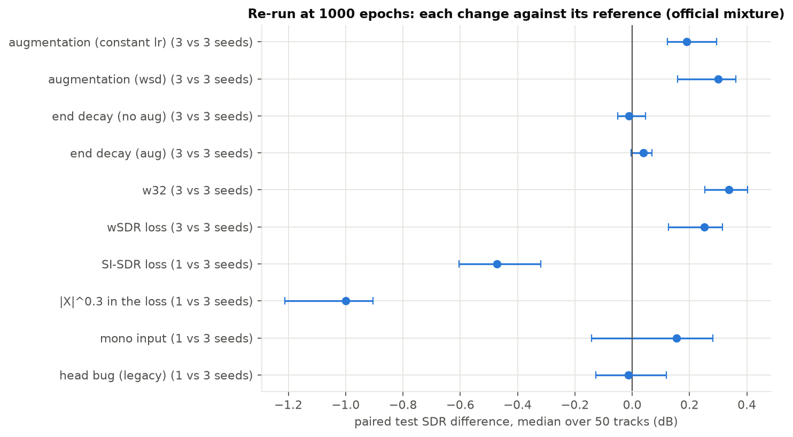

# 11 · The 150-epoch experiments again, at budget B and with the phase-2 recipe

[← back to README](../README.md)

**Status.** Prepared before the tag `final-v1`, while phase 2 was still running: hypotheses, predictions and rules below are in git before any phase-3 run starts. The recipe itself (`src/configs/experiment/recipe.yaml`) is filled after the phase-2 decision ([10](10_recipe.md)); everything else on this page does not depend on it.

**Result in one line.** On validation at 1000 epochs: w32 +0.46 dB and wSDR +0.24 dB (3 seeds, real), SI-SDR loss −0.69 dB and compressed loss −1.28 dB (real losses), head bug +0.13 dB (inconclusive); mono is not comparable on validation and is decided on test.

## Why these runs and not the others

Experiments 02 to 07 were run at 150 epochs, where every model was still improving ([09](09_convergence_probe.md): the baseline gains 0.6 dB on validation between epochs 150 and 1000). Their comparisons mixed "which model is better" with "which model learns faster". This phase re-runs the ones whose conclusion can flip and that matter for the final model, at B = 1000 epochs, against the phase-2 recipe. The 150-epoch results stay in the README as the short-budget column.

Not re-run (decided on 16 Oct for time): w4, w8 and w64 ([06](06_size_quality.md); w64 is over the 4 GB budget anyway), context length ([07](07_context_length.md): its conclusion rests on the 4.42 s receptive field, which does not depend on the budget), `power_in` and `norm` ([05](05_amplitude_compression.md)), the multi-resolution STFT loss ([04](04_waveform_loss.md): it failed by instability, not by lack of training) and the learning-rate grid ([03](03_lr_schedule.md)).

## Runs (group `final` of [deploy/queue.yaml](../deploy/queue.yaml))

One variable changed against `experiment=recipe` (w16 stereo, B = 1000 epochs, no early stopping, last checkpoint):

| run | change | seeds | from |
|---|---|---|---|
| `f_w32` | `model.base_channels=32` | 42, 43, 44 | [06](06_size_quality.md) |
| `f_wsdr` | `model.loss_type=wsdr` | 42, 43, 44 | [04](04_waveform_loss.md) |
| `f_sisdr` | `model.loss_type=sisdr` | 42 | [04](04_waveform_loss.md) |
| `f_power_loss` | `model.loss_power=0.3` | 42 | [05](05_amplitude_compression.md) |
| `f_mono` | `data.channels=1` (and `channel_swap=false`) | 42 | [02](02_mono_vs_stereo.md) |
| `f_legacy` | `model.legacy_head=true` | 42 | [01](01_baseline_vs_oracle.md), the head bug |

Three seeds where a decision depends on it: w32 is the candidate final model, wSDR the only loss that looked promising (+0.31 dB on validation at 150 epochs). The others get one seed: they either settle by a large margin or are reported as inconclusive. Reference: the three seeds of the phase-2 cell chosen as recipe (same code: `git diff recipe-v1 final-v1 -- src/` touches nothing outside `src/configs`).

## Decision rule

- Score of a run: mean of `val/si_sdr_median` over epochs 991 to 1000 (`python -m analysis.convergence at --epoch 1000`). Validation only.
- σ_seed: the pooled seed standard deviation measured in phase 2 (`figures/convergence_decide.json`).
- **3-seed variant against the 3-seed reference**: difference of two means, standard deviation σ_seed·√(2/3); the effect is called real if it exceeds **2·σ_seed·√(2/3)**.
- **1-seed variant against the 3-seed reference**: one run against a mean of three, standard deviation σ_seed·√(1 + 1/3); real if the difference exceeds **2·σ_seed·√(4/3) ≈ 2.31·σ_seed**. Below that: **inconclusive**, not "no effect".
- Verdicts are worded Confirmed / Rejected / Inconclusive against the predictions below.

## Hypotheses and predictions

1. **w32 (H1 against H2 of [06](06_size_quality.md)).** H1: the +0.22 dB of w32 at 150 epochs came from faster convergence, and the gap shrinks at B. H2: with augmentation the larger model has data to use its capacity, and the gap grows. The probe (one seed) supports H2 with augmentation (+0.07 dB at epoch 150, +0.49 dB at epoch 1000) and H1 without it (+0.35 → +0.26 dB). **Prediction: w32 − w16 between +0.25 and +0.5 dB if the recipe has augmentation, between +0.1 and +0.3 dB without it.** H1 and H2 are read from the gap at epoch 150 against epoch 1000 of the same runs (validation is logged every epoch). Peak VRAM of w32 on the GTX 1650: 2.63 GiB ([06](06_size_quality.md)), inside the budget.
2. **wSDR.** At 150 epochs: +0.31 dB on validation, +0.12 dB [−0.10, +0.36] on test. Near convergence the mismatch between an amplitude loss and a waveform metric may matter more. **Prediction: between 0 and +0.3 dB; more likely inconclusive than kept.**
3. **SI-SDR loss.** At 150 epochs: +0.11 dB test SDR, no SI-SDRi gain. **Prediction: inconclusive.** ⚠ Bias of the rule: this model optimises exactly the validation metric, so its validation gain is an upper bound; if it passes the threshold, the decision is only confirmed if the test SDR of phase 5 agrees.
4. **Compression in the loss (`|X|^0.3`).** At 150 epochs: −0.82 dB test, −1.1 dB validation. Two explanations ([05](05_amplitude_compression.md)): slower convergence (then the gap shrinks at B), or the weight the compressed loss gives to the bins above 16 kHz that the AAC codec emptied (12 times more than the linear loss), which does not depend on the budget. **Prediction: the gap stays, between −0.5 and −1.0 dB** (I expect the codec weighting to dominate). A gap below 0.3 dB in absolute value would reject this and point to convergence.
5. **Mono.** At 150 epochs: +0.04 dB [−0.18, +0.17] for stereo. **Prediction: inconclusive** (below 2.31·σ_seed).
6. **Head bug.** The mask is capped at sigmoid(b) (0.727 in the old checkpoint, i.e. at least −2.8 dB on bins dominated by the voice) and constant on the bins where the head ReLU is off. SI-SDR is scale-invariant, but this cap is not a uniform gain: it distorts the estimate where the voice dominates. **Prediction: clearly worse, by 0.3 to 1.5 dB** (⚠ wide range: no clean measurement exists, the only pre-fix test score is not comparable, see [01](01_baseline_vs_oracle.md)).

**If a prediction fails.** Each run says something either way: a w32 gain that shrinks (H1) means width was mostly a speed-up; a `power_loss` gap that closes means the 150-epoch result was a convergence artefact; a head bug that costs nothing means the network learned around it.

## Results

Phase 3 finished on 17 Oct 2026 (tag `final-v2`; `final-v1` failed at config composition because `recipe.yaml` had no `wandb` key, no run trained). Validation only, written and committed before any test evaluation. Numbers in `figures/final_decide.json`.

Reference: the `const_aug` cell of [10](10_recipe.md), seeds 4.743 / 4.632 / 4.871, **mean 4.749 dB**. σ_seed = 0.089 dB. Score of a run: mean of `val/si_sdr_median` over epochs 991 to 1000.

| run | seeds | scores | Δ vs reference | threshold | verdict on validation |
|---|---|---|---|---|---|
| `f_w32` (seed 42 = probe_w32_aug) | 3 | 5.231 / 5.117 / 5.273 | **+0.458** | 0.145 | **real gain** |
| `f_wsdr` | 3 | 4.993 / 4.932 / 5.053 | **+0.244** | 0.145 | **real gain** |
| `f_sisdr` | 1 | 4.059 | **−0.689** | 0.206 | **real loss** |
| `f_power_loss` | 1 | 3.470 | **−1.278** | 0.206 | **real loss** |
| `f_legacy` | 1 | 4.873 | +0.125 | 0.206 | inconclusive |
| `f_mono` | 1 | 5.483 | (+0.735) | | **not comparable on validation** (below) |

**The mono model is not scored on the same validation set.** With `data.channels=1`, the 240 validation crops are built from the mono downmix: the mixture's SI-SDR is −3.91 dB on them against −4.28 dB on the stereo crops, and the oracle gets 10.14 dB against 9.21 dB. The oracle alone gains 0.93 dB from the change of set, so the +0.735 dB of the model says nothing about stereo against mono. This is the protocol trap of [02](02_mono_vs_stereo.md) again, which the decision rule above did not foresee. Deviation: mono is decided on the test set under the stereo protocol (`src.evaluate` applies a mono model to L then to R), the only protocol where both models are scored on the same signals. The phase-5 test numbers decide it, and this paragraph is committed before they exist.

Gap w32 − w16 (augmented, 3 seeds each) along the runs: +0.27 dB at epoch 150, +0.35 at 300, +0.45 at 600, **+0.46 at 1000**.

### Against the predictions

1. **w32: confirmed, H2.** +0.458 dB, inside the predicted +0.25 to +0.5 dB for a recipe with augmentation. The gap grows with training (+0.27 → +0.46 dB) instead of shrinking: with augmentation, the extra width is used, it is not only a faster start. **w32 is the final model under 4 GB** (2.63 GiB peak on the GTX 1650, [06](06_size_quality.md)).
2. **wSDR: kept, better than predicted.** +0.244 dB on 3 seeds, above the threshold; I predicted "more likely inconclusive". It was never trained at width 32, so w32 + wSDR is not tested here: the final model stays w32 with the L1 loss, and the combination is a follow-up, not an assumption.
3. **SI-SDR loss: rejected, and the other way.** −0.689 dB, while I predicted inconclusive, and the model is below the reference on its own training metric over the whole run (3.03 against 3.12 dB at epoch 150, 4.06 against 4.75 at epoch 1000). So the upper-bound bias I worried about did not happen. ⚠ No tested explanation; at 150 epochs and without augmentation the same loss was +0.07 dB, so the interaction with augmentation or the length of training is the first thing to look at.
4. **Compression in the loss: confirmed, larger than predicted.** −1.278 dB (predicted −0.5 to −1.0): the gap did not close with training, so the 150-epoch loss was not a convergence artefact. The codec-weighting explanation of [05](05_amplitude_compression.md) stays the candidate; the mask histogram (phase 4) can test the other one.
5. **Head bug: prediction rejected.** +0.125 dB, inconclusive, where I predicted a clear loss. At this budget the network with BN + ReLU before the head is not measurably worse. The cap is sigmoid(b) only when the learned head weights are negative; the 0.727 cap of the old checkpoint is not a property of the architecture. To check on its checkpoint (mask maximum and share of bins at the cap) before writing anything stronger.
6. **Mono: decided on test** (above).

## Test (phase 5)

Evaluated after the decisions above were committed (`8e54341`): last checkpoint of every run, 50 test tracks, official mixture, stereo museval v4. `uv run python -m analysis.final_test` → `figures/final_test.json`. Each configuration is the per-track mean over its seeds; paired difference against the reference, median [95 % bootstrap CI over tracks], wins out of 50. The CI covers tracks only; the seed medians show the seed spread.

| model (test SDR, official mixture) | median [95 % CI] | seed medians |
|---|---|---|
| 150-epoch baseline (w16, no augmentation) | 4.47 [3.54, 5.37] | 4.47 (1 seed) |
| recipe: w16 + augmentation, 1000 epochs | 5.45 [3.89, 5.95] | 5.54, 5.38, 5.32 |
| **final: w32 + augmentation, 1000 epochs** | **5.89 [4.29, 6.30]** | 5.72, 5.82, 5.92 |
| Open-Unmix `umx`, same pipeline, no Wiener | 6.06 [5.32, 7.30] | |
| Open-Unmix `umx`, same pipeline, Wiener (default) | 6.43 [5.21, 7.24] | |

| change (variant − reference) | validation decision | test: paired Δ [95 % CI] | wins | agrees? |
|---|---|---|---|---|
| w32 (3 vs 3 seeds) | +0.46, real | **+0.34 [+0.25, +0.40]** | 44/50 | yes |
| wSDR loss (3 vs 3) | +0.24, real | **+0.25 [+0.13, +0.32]** | 39/50 | yes |
| SI-SDR loss (1 vs 3) | −0.69, real | **−0.47 [−0.60, −0.32]** | 5/50 | yes |
| \|X\|^0.3 in the loss (1 vs 3) | −1.28, real | **−1.00 [−1.21, −0.90]** | 1/50 | yes |
| head bug (1 vs 3) | +0.13, inconclusive | −0.01 [−0.13, +0.12] | 23/50 | yes (no effect) |
| **mono input (1 vs 3)** | not comparable | **+0.15 [−0.14, +0.28]**, p = 0.41 | 29/50 | decided here: **inconclusive** |
| augmentation, constant lr (phase 2) | +0.24 | +0.17 [+0.09, +0.30] | 37/50 | yes |
| augmentation, wsd (phase 2) | +0.27 | +0.30 [+0.16, +0.36] | 44/50 | yes |
| end decay, no aug (phase 2) | +0.11 | −0.05 [−0.12, −0.00] | 18/50 | no gain on test either |
| end decay, aug (phase 2) | +0.14 | +0.04 [−0.00, +0.07] | 31/50 | no gain on test either |
| recipe vs 150-epoch baseline | | +0.64 [+0.50, +0.71] | 45/50 | |
| **final w32 vs 150-epoch baseline** | | **+0.99 [+0.88, +1.17]** | 48/50 | |
| final w32 vs Open-Unmix (Wiener) | | −0.55 [−0.78, −0.33] | 14/50 | |
| final w32 vs Open-Unmix without Wiener | | −0.27 [−0.51, −0.10] | 14/50 | |

⚠ `recipe-v1/r_const_s44` failed its test evaluation (oracle-cache collision, fixed in `src/models/oracle.py`) and was being re-run when these numbers were written: the `const` cell has 2 seeds on test. Re-run `analysis.final_test` once it is fetched.

- **Every validation decision holds on test**, with the same sign; the sizes shrink a little (w32 +0.46 → +0.34, SI-SDR loss −0.69 → −0.47, compression −1.28 → −1.00), as expected from a selection made on validation. The end decay, not kept on validation, does not gain on test either.
- **Mono against stereo: no measurable difference**, as at 150 epochs ([02](02_mono_vs_stereo.md)). One mono seed, CI including 0.
- **The re-run moved the result by about 1 dB**: 4.47 → 5.89 dB, better on 48 of 50 tracks, with the same architecture family, under the same 4 GB budget (w32: 2.63 GiB). The gap to Open-Unmix goes from 1.69 dB to 0.55 dB (0.27 dB against Open-Unmix without its Wiener filter, i.e. with the same kind of reconstruction).
- The two near-silent tracks (*PR - Happy Daze*, *PR - Oh No*) stay broken for the waveform losses (sisdr −33 and −8.5 dB, wsdr −23 to −30 and −4 to −6 dB, against −14 to −1 and about 0 dB for the reference): the energy-normalised losses still never learn silence. Medians are not affected.

## Checkpoint analyses (phase 4)

On the 240 validation crops, so no test track is involved, except the Wiener filter.

**Head bug** (`uv run python -m analysis.mask_stats ...`, `figures/mask_stats.json`). Head of the 1000-epoch legacy run: weights [[−1.06, +1.48], [−1.07, +1.48]], bias −0.36. Each output channel has one **positive** weight on a ReLU input, so the mask is not capped: it reaches 1.0 and no bin sits at a fixed ceiling (0.0 %), against a cap of 0.727 on 46 % of the bins in the pre-fix checkpoint. The bug is a ceiling only when training happens to make all the head weights of a channel negative; this run did not, which explains why it costs nothing here. The fix stays right (it removes a failure mode), but "the bug cost X dB" cannot be claimed.

**Compressed loss** (same script). Hypothesis of [05](05_amplitude_compression.md): `|X|^0.3` pushes the mask to 0 where the voice is weak. **Rejected**: among the bins where the ideal ratio is between 0.1 and 0.5, the mask is below 0.05 on 6.1 % of them for `power_loss`, against 14.7 % for the reference; it zeroes weak voice *less*. Its mean mask is lower (0.46 against 0.49). The other explanation (the weight the compressed loss gives above 16 kHz, where the codec emptied the spectrum) is untested.

**Output level of the waveform losses** (`analysis.output_scale` on 80 validation crops, `figures/output_scale_1000ep.json`). Median scale cost (what the SNR would gain with the right level): reference 0.14 dB, sisdr 0.11 dB, wsdr 0.06 dB; median optimal gain −0.68, −0.64 and −0.15 dB. The level is not what makes the SI-SDR loss worse (its scale cost is the reference's); the wSDR model has the best-calibrated level, as its scale-sensitive noise term ([04](04_waveform_loss.md)) is meant to give.

**Wiener post-processing of the final model** (`src/evaluate_wiener.py`): see below.

**Wiener filter on the final model: preliminary, 30 of 50 tracks.** `src/evaluate_wiener.py` applies one EM iteration of Open-Unmix's multichannel Wiener filter inside each 5.93 s inference window, with the two source models |V| = m·|X| and |A| = (1 − m)·|X| from the U-Net mask. On the 30 tracks evaluated so far (seed 42 of w32, official mixture): paired difference **−0.08 dB [−0.20, −0.02]**, better on 9 of 30 tracks; median SIR 9.6 → 10.7 dB, SAR 1.9 → 2.0 dB. So the filter does not reproduce the +0.16 dB it brings to Open-Unmix: it removes a little more accompaniment and the SDR does not follow. A plausible reason (⚠ untested): with only two sources, the accompaniment model is the exact complement of the vocals model, so the filter has no independent estimate to arbitrate between, unlike the four independent targets of Open-Unmix. The run is incomplete because the 7 GB development machine runs out of memory on the longest test tracks, and one track (*Punkdisco - Oral Hygiene*) gave a NaN estimate (bins where both source models are 0; a floor of 1e-8 was added afterwards). To be re-run on the server, on all 50 tracks, before stating more than "no gain".
